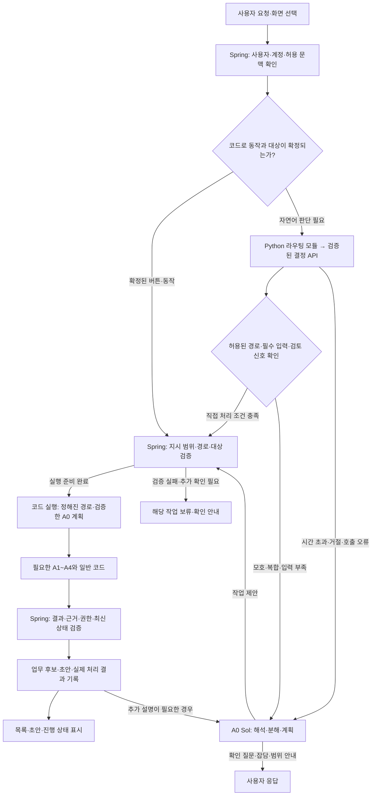
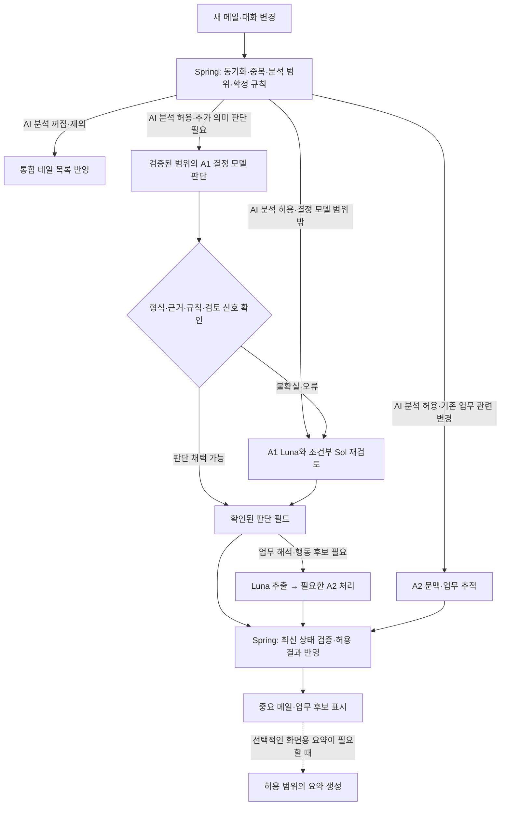

# 통합 이메일 AI 비서 — 에이전트+결정모델 세부 구조 v1.0

- 작성일: 2026-10-02
- 최신 개정일: 2026-10-29
- 문서 목적: 일반 LLM 기반 멀티에이전트를 기준으로, GPT Decisions 우선 검증·Jev 비교 후보의 제한된 판단·라우팅과 생성 LLM을 결합하는 구조를 정리한다.
- 문서 상태: **GPT Decisions API를 먼저 검증하고 기준 통과 범위를 초기 운영에 사용하는 상세 설계안. Jev는 비교 후보로 유지하며, Luna·Sol 기준선·생성·복귀 역할과 결과 미반영 평가를 구분한다.**
- 구현·검증 상태: 실제 API 호출·한국어 평가·운영 적용 전. 성능·정확도·비용 절감의 달성을 주장하는 문서가 아니다.
- 관련 문서: [일반 LLM 기반 에이전트 상세 설계 v0.3](01-에이전트-상세-설계-v0.3.md), [기술 스택 보고서](06-기술-스택-선택-비교-보고서-v1.0.md), [웹앱 기획서](07-웹앱-기획서-v1.6.md), [후속 결정 목록](10-후속-결정-목록-v1.0.md), [Jev와 외부 AI 개인정보 검토](11-Jev와-외부-AI-개인정보-검토-v1.0.md)

## 1. 설계 목적과 결정 상태

일반 LLM형은 A0 Sol이 사용자 요청을 해석·분해하고, A1~A4가 정해진 역할을 수행하는 기준 구성이다. 결정 모델 도입형은 이 역할 안에서 선택지가 정해진 판단과 업무 경로 선택을 GPT Decisions API로 먼저 검증하고, Jev를 비교 후보로 둔다. 복잡한 요청의 해석·계획은 A0, 요약·행동 후보·답장 생성은 생성 LLM, 실제 상태 변경과 실행은 Spring이 담당한다.

두 구성은 동일한 메일·업무 서비스, 권한 검사, 작업 기록과 전문 역할을 공유한다. 모델별 어댑터와 적용 설정으로 비교하며, 서로 다른 제품이나 별도 업무 DB를 만드는 구성을 전제로 하지 않는다.

| 상태 | 내용 |
| --- | --- |
| 사용자 확정 | Luna·Sol 기준 성능 확보 → GPT Decisions API 우선 검증 → 기준 통과 범위의 초기 운영 사용. 보유 OpenAI API 크레딧을 고려한 선택이며 Jev는 비교 후보로 유지(2026-10-29) |
| 사용자 확정 | C안의 기준선·결과 미반영 평가·검증 범위 제한 원칙 유지. 합성 자료부터 시작하며 실제 베타 자료는 처리 조건을 갖춘 뒤 사용. 화면·상호작용 프로토타입 검토 후 실제 서버·AI 연결 |
| 사용자 확정 | A0 오케스트레이터·A4 응답 작성은 Sol. A1 메일 이해·분류, A2 문맥·업무 추적, A3 서비스·수신 관리는 Luna 기본과 조건부 Sol 재검토 |
| 사용자 확정 | 현재 재정과 자체 실행 환경 미구축을 고려해 초기 판단·생성 LLM은 외부 API로 호출. 로컬·별도 클라우드 GPU의 공개 모델 자체 운영은 보류하며 Sol·Luna 기준선·생성·복귀 역할 유지(2026-10-29). 실행 기준은 [스택 보고서 9.2](06-기술-스택-선택-비교-보고서-v1.0.md#92-ai-실행-도구와-작업-책임) |
| 사용자 확정 | Spring Boot 공용 백엔드와 Python/FastAPI AI 영역 분리. PostgreSQL·SQS Standard와 Spring의 작업 최종 상태 관리 |
| 사용자 승인 | 에이전트별 비용 관찰, 판단과 추출·생성의 논리적 분리, 선택적인 화면용 요약 지연, 확률 구간별 실제 오류 기록(2026-10-02) |
| 사용자 승인 | 직접 조회·키워드 검색 기반의 RAG와 관련 과거 메일 탐색의 임베딩 보강. 제목·본문부터 제한 검증하고 일반 LLM형·결정 모델 평가에 같은 검색·권한 경계 적용(2026-10-13). 역할별 적용은 7.6 |
| 사용자 문서화 요청 | 지금까지 검토한 Jev 도입형 아키텍처를 기존 원문과 구분한 새 문서로 정리(2026-10-02) |
| 사용자 요청 반영 | A0 기능별 계약·관찰과 계층형 비교를 구체화. Sol 기준선, Luna 기본안, 결정 모델 게이트 안의 비교이며 운영 전환은 평가 후 선택(2026-10-06) |
| 사용자 요청 반영 | 기존 초기 직접 처리 비교 범위를 유지하고, 요청 구성 요소별 판단·전체 요청 충족 검사·충돌 시 원문 기반 A0 복귀를 보강. 추가 비용·지연은 질문 추가분과 실제 A0 비율 변화로 나눠 계산(2026-10-07) |
| 사용자 요청 반영 | 공식 TypeSafe 질문 형식에 맞춘 초기 라우팅 질문 10개와 합성 검토 사례 34개를 작성. 질문 문구·입력·기대 의미·서버 결합 조건을 명세하며 실제 모델 결과·운영 임계값과 구분(2026-10-07) |
| 설계·비교 제안 | 제한된 업무 경로 선택으로 일부 A0 호출 생략, 불확실한 라우팅의 A0 Sol 복귀, 역할 내부의 선택형 판단 보조 |
| 미정 | 실제 적용할 경로·모델별 임계값·입출력 명세·시간 및 비용 한도·제공사 호출 경로·운영 전환 범위 |

이 문서의 라우팅 경로와 내부 필드명은 구현·평가를 위한 설계안이다. A1 판단 필드와 제한된 A0 라우팅은 별도 과제로 평가하고 GPT Decisions API를 우선 검증한다. 기존 `jev-1.13.0` 요청 예시는 Jev 비교 자료로 보존하며, 실제 비교 시 사용할 고정 버전·접근 가능 여부·계약은 별도로 확인한다. Luna·Sol과 결정 API의 실제 호출 모델·엔드포인트·설정을 기록한다.

첫 [화면 프로토타입](14-웹-프로토타입-기획서-v1.0.md)은 가상 자료와 정해진 응답으로 사용자 경험을 확인하며 모델 어댑터를 호출하지 않는다. 그 이후 Luna·Sol 기준선과 GPT Decisions의 결과 미반영 평가를 수행한다. 기존 품질·안전·지연·비용 기준과 사전에 정한 기능별 수용 기준을 통과한 범위를 초기 운영에 사용한다. Jev 비교 완료를 선행 조건으로 두지 않으며, 기준 미달·미검증·호출 실패 범위는 기존 LLM 경로로 처리한다.

**본문의 적용 범위:** 공통 흐름·권한·복귀·관찰·평가 원칙은 GPT Decisions와 Jev에 모두 적용한다. 5.5의 기존 TypeSafe 요청 예시·Noul 명세와 10.3의 Jev 비용 계산은 비교 자료이며 GPT API의 실제 계약·비용으로 간주하지 않는다. GPT 질문 변환은 5.5.4, 크레딧 관찰은 10.1, 초기 운영 조건은 11.3을 따른다.

## 2. 일반 LLM형과 결정 모델 도입형의 차이

| 항목 | 일반 LLM형 기준 구성 | 결정 모델 도입형 설계안 |
| --- | --- | --- |
| 자연어 요청 진입 | A0 Sol이 의도·대상·작업 순서를 해석 | 제한된 업무 경로는 결정 모델로 선택하고, 준비된 입력으로 실행 가능한 경우 A0 호출 생략 검토 |
| 복합·모호한 요청 | A0가 요청 항목과 의존 관계를 구성 | A0가 동일한 역할 수행. 정해진 복합 업무 경로에 완전히 들어맞는 경우만 직접 연결 검토 |
| A1 판단 | Luna가 필요한 분류·업무 신호를 판단 | 검증된 판단 필드를 결정 모델이 담당하고 불확실한 경우 기존 Luna·Sol 경로로 복귀 |
| 추출·생성 | Luna의 요약·행동 후보, Sol의 답장 초안 | 동일한 생성 역할 사용. 선택적인 화면용 요약만 필요 시 지연 |
| A2·A3 | Luna가 문맥·서비스 조건을 해석하고 필요시 Sol 재검토 | 이미 준비한 후보 중 선택 등 좁은 판단만 후속 비교 |
| 버튼·동기화·기한 이벤트 | 코드가 이미 정해진 경로를 실행 | 동일한 코드 경로 사용. 라우팅이 필요 없는 이벤트에 결정 모델을 추가하지 않음 |
| 실행·업무 상태 | Spring이 권한·최신 상태·중복을 검사해 확정 | 동일한 책임. 결정 모델 출력은 실행 권한이나 업무 완료의 증거가 아님 |
| 관찰·평가 | 역할별 비용·지연·품질 기록 | 결정 모델 비용·선택 경로·복귀 사유·경로 오류와 전체 업무 결과를 추가 비교 |

여기서 **에이전트·업무 경로 라우팅**은 어떤 역할과 처리 순서를 사용할지 고르는 것이다. **모델 라우팅**은 같은 판단에 Luna 또는 Sol을 사용할지 고르는 것이다. **작업 계획**은 새로운 요청을 나누고 의존 관계를 만드는 것으로, A0의 책임이다. 세 기능의 비용과 오류를 따로 집계한다.

## 3. 전체 구조와 배치

### 3.1 사용자 요청의 처리 구조

아래는 검증을 통과한 범위에 적용할 후보 흐름이다. 결과 미반영 비교 단계에서는 결정 모델의 선택을 평가 기록에만 남기며, 실제 사용자 처리는 기존 경로로 진행한다.



선택된 경로가 허용 목록에 있다는 사실만으로 사용자의 의도와 일치한다고 확정하지 않는다. 입력 부족·결과 충돌은 실행 전에 걸러내고, 의미상 잘못된 경로 선택은 실제 업무 결과 평가로 확인한다. 결과 설명을 위해 A0를 다시 호출하면 해당 비용·지연도 전체 처리에 포함한다.

### 3.2 시스템 책임과 배포 단위

| 구성 | 책임 |
| --- | --- |
| 웹·후속 앱 | 사용자 입력, 현재 선택한 메일·업무, 진행 상태·초안·확인 UI |
| Spring | 사용자·계정 권한, 문맥 접근, 허용 경로·입력 검증, 메일·업무·규칙의 최종 상태, 실제 실행 |
| Python/FastAPI·AI 워커 | A0~A4, 결정 모델 요청 구성·응답 검증, 생성 모델 호출, 판단·제안 반환 |
| 결정 모델 어댑터 | 허용된 상태와 제한된 질문 전달, 선택·확률·사용량의 제공사별 차이 정리 |
| PostgreSQL·SQS | Spring의 영구 작업 기록과 outbox, 작업 전달·재전달·완료 기록 |
| 관찰·평가 기록 | 역할·호출·모델·경로·비용·오류를 작업 ID로 연결. 운영 데이터와 비교 결과의 적용 경계 유지 |

결정 모델 판단은 기존 Python 역할 모듈에서 호출한다. FastAPI는 HTTP 입출력을 제공하고 장기 분석은 AI 워커에서 처리한다. 각 역할이나 결정 모델 호출마다 별도 서비스를 배포할 필요는 없다. 초기 VM·Docker 및 이후 확장 기준은 [스택 보고서](06-기술-스택-선택-비교-보고서-v1.0.md)와 [인프라 고도화 계획](09-인프라-고도화-계획-v1.0.md)을 따른다.

## 4. 역할별 책임과 결정 모델 적용 범위

| 역할 | 결정 모델이 맡을 수 있는 판단 | 생성 LLM과 코드에 남는 책임 | 비교 우선순위 |
| --- | --- | --- | --- |
| A0 오케스트레이터 | 지원하는 업무 경로 선택, 현재 요청이 직접 처리 후보인지 판단 | 복합 요청 분해·문맥 해석·예외 조건·규칙 작성·추가 질문·결과 설명은 Sol. 허용 경로와 실제 호출은 코드 | 제한된 라우팅의 추가 비교 후보 |
| A1 메일 이해·분류 | `mail_type`, `importance`, `needs_reply`, `task_signal`, 제시된 근거 구간 선택 | 요약·행동 언급 후보 추출은 Luna. 규칙 충돌·문맥 부족·근거 불일치 등은 기존 Sol 재검토. 날짜·ID·중복은 코드 | 기존 첫 비교 대상 |
| A2 문맥·업무 추적 | 준비된 관련 업무 후보와 변경 종류 중 제한된 선택 | 문맥 해석·부분 답변·변경 값 추출·다중 업무 연결은 Luna와 필요시 Sol. 최신 업무 상태와 저장은 Spring | A1·라우팅 검증 이후 후보 |
| A3 서비스·수신 관리 | 준비된 서비스·알림 유형 후보의 구분 | 유지할 알림·해제 범위의 해석은 Luna와 필요시 Sol. 실제 서비스 상태 조회·변경은 Spring 커넥터 | 처리량·효과를 확인한 뒤 검토 |
| A4 응답 작성 | 별도 결정 모델 작성 역할을 두지 않음 | 허용된 대화·업무 근거로 Sol이 초안 작성. 서버 검증 후 사용자가 확인·발송 | 생성 모델 역할 유지 |

결정 모델의 선택형 판단은 업무 제목·요약·답장·임의의 도구 인자를 생성하는 역할과 구분한다. 경로만 골랐지만 발신 계정·대상 메일·새 기한 등을 추가 해석해야 한다면 기존 역할에 연결한다. 그 추가 호출을 비용 계산에서 제외하지 않는다.

A2의 출력은 기존 `changes[]` 구조처럼 한 메일의 여러 업무·여러 변경을 표현할 수 있어야 한다. 후보 하나나 변경 종류 하나만 고르게 해 기존 기능을 축소하지 않는다. 후보 검색에서 누락된 업무는 선택 모델이 복구할 수 없으므로 검색 누락과 판단 오류도 구분한다.

A0의 초기 모델은 Sol이며, 기능별 배분 후보는 [기획서 9.5.1](07-웹앱-기획서-v1.6.md#951-a0-기능-분리와-계층형-비교)을 따른다. 대화 판정·입력 추출·규칙 작성·응답과 설명을 구분해 관찰하되 한 호출에서 함께 처리할 수 있다. Luna의 판정·추출과 Sol 승격을 별도 결정 모델 게이트 구성과 함께 비교하며, 게이트의 추가 호출을 필수로 두지 않는다. 혼합·모호·규칙 요청은 Sol 우선 비교 대상이지만 단일 요청의 긴 문맥·예외도 평가한다.

계층형 비교에서 일반 Luna 경로는 지속 규칙 저장으로 연결할 수 없도록 Spring이 허용 동작·결과 계약을 제한한다. 규칙 생성·변경 제안은 Sol 규칙 전용 작업으로 연결하고 사용자 지시·대상·예외를 검증한 뒤 Spring이 저장한다. 모델 이름이나 점수가 저장 승인을 대신하지 않으며, Sol이 잘못 만든 규칙과 게이트가 놓친 규칙 요청도 평가 대상이다.

## 5. 제한된 라우팅의 계약안

### 5.1 입력 구성

다음은 우리 백엔드 내부 계약의 항목 제안이며, 특정 제공사의 API 필드명을 그대로 옮긴 명세가 아니다. 권한 정보는 서버가 정하고 모델 입력에는 판단에 필요한 최소 설명만 전달한다.

| 항목 | 구성 기준 |
| --- | --- |
| 요청·대화 문맥 | 현재 사용자 발화와 필요한 이전 대화. 짧은 지시의 대상이 될 현재 화면·선택 정보 포함 |
| 허용된 대상 | 서버가 확인한 계정·메일·업무의 참조와 버전. 선택 의미를 이해하는 데 필요한 설명을 함께 제공 |
| 업무 경로 목록 | 지원하는 경로의 ID·의미·필수 입력·적용 조건. 처리 불가·A0 해석 필요 선택지 포함 |
| 준비된 입력 | 서버 상태에서 확인 가능한 계정·대상·조회 범위와 누락된 항목 |
| 판단 질문 | 경로 선택과 남은 요청·문맥 부족 같은 제한된 보조 판단. 서로 독립적인 질문은 같은 허용 상태로 묶어 호출 가능 |
| 내부 실행 정보 | 작업 ID·운영/평가 모드·경로 정의 버전·규칙 버전·잔여 한도. 제공사에 보낼 값과 내부 기록을 구분 |

최초 라우팅을 위해 전체 메일함·본문·첨부를 일괄 조회하지 않는다. 메일 내용을 제공해야 하는 단계에서는 분석 제외·계정 간 참조 제한을 먼저 적용한다. 메일에 적힌 명령문을 사용자의 요청이나 시스템 권한으로 취급하지 않는다.

### 5.2 출력과 서버 판정

| 항목 | 의미와 처리 주체 |
| --- | --- |
| 제안 경로 | 결정 모델이 허용 후보 중 선택한 경로. 실제 실행 경로와 별도 기록 |
| 원래 확률·confidence | 제공사가 반환한 종류와 값을 보존. 없는 값을 만들어 채우지 않음 |
| 보조 판단 | 요청 일부가 남았는지, 문맥이 부족한지 등. 기존 서버 검사와 평가를 보완하는 신호 |
| 실제 처리 경로 | 서버가 경로·입력·정책 검사 후 선택한 경로 또는 A0 복귀·보류 |
| 복귀·보류 사유 | 낮은 확실성, 미지원 경로, 필수 입력 부족, 판단 충돌, 호출 실패, 오래된 상태 등 |
| 호출 기록 | 모델·질문·입출력 계약·경로 정의 버전, 시간·실제 사용량·비용·시도 정보 |

Choice는 제시한 후보 선택, Score는 정한 수준의 평가, Noul은 명제의 참일 확률에 사용한다. 위 이름은 TypeSafe 형식이다. GPT Decisions의 참 여부 판단은 Predicate로 표현하며, Noul·Predicate의 확률과 Choice·Score의 confidence를 같은 값으로 취급하지 않는다. 모델 점수를 실제 정답률이나 실행 승인으로 해석하지 않는다. [TypeSafe 질문과 응답](https://docs.typesafe.ai/primitives)

공통 어댑터는 판단 결과·근거·모델·버전·사용량을 연결하되, 점수의 종류·제공 여부·원래 값을 보존한다. 모든 모델에 `probs`·`confidence`를 필수로 강제하거나 없는 점수를 만들어 채우지 않는다. 재검토 정책은 어댑터 바깥에서 관리하고 임계값·보정은 모델·업무별 평가에 따른다. 출력 모양만 같게 만든 뒤 동일 임계값으로 교체하지 않는다.

enum·yes/no 출력만으로 추론이 불필요하다고 판단하지 않는다. 서버 검사를 통과해도 허용된 다른 대상을 잘못 고르거나 요청 일부를 누락할 수 있다. 높은 확률의 잘못된 단순 요청 판정도 평가하고, Structured Outputs의 형식 준수를 의미 정확성이나 요청 전체 처리의 보장으로 사용하지 않는다. [OpenAI 구조화 출력의 오류 처리](https://developers.openai.com/api/docs/guides/structured-outputs#handling-mistakes)

Luna의 enum·logprobs 조합은 선택적인 실험 항목이다. 토큰 확률은 업무 정답률이나 결정 모델의 선택지 확률·confidence와 동일하지 않으며, 한 JSON에서 순서대로 생성한 필드를 결정 모델의 독립 질문과 같은 계산으로 취급하지 않는다. 실제 모델·엔드포인트·추론 설정·구조화 출력의 호환성을 확인한 뒤 평가한다. 공정한 비교에는 같은 허용 사실·판단 기준·최종 업무 품질을 사용한다. [토큰 확률 설명](https://developers.openai.com/api/docs/guides/advanced-usage#token-log-probabilities), [호환성 검토 기준](06-기술-스택-선택-비교-보고서-v1.0.md#93-ai-판단추출과-비용품질-관찰)

한 호출에 묶은 질문은 같은 상태를 독립적으로 평가한다. 근거 선택 질문이 다른 질문의 판단 결과를 자동으로 알고 있다고 가정하지 않는다. 앞선 결과로 새 자료나 후보를 구성해야 하면 별도 단계가 필요하며, 이 호출도 비용·지연에 포함한다. [질문 간 의존 관계](https://docs.typesafe.ai/primitives#when-one-question-depends-on-another)

### 5.3 업무 경로 후보

아래 ID와 범위는 초기 비교를 위한 예시다. 실제 지원 목록과 필수 입력의 명세는 라우팅 프로토타입 전에 선택한다.

| 경로 후보 | 필요한 입력과 조건 | 연결할 처리 |
| --- | --- | --- |
| `draft_selected_thread` | 선택한 대화·발신 계정과 요청 범위가 명확함 | 허용 문맥 준비 → 필요시 A2 → A4 초안 → 서버 검증·표시 |
| `find_unanswered_requests` | 계정·조회 대상·기간 등 검색 범위가 준비됨 | Spring의 상태 조회 → A2의 요청·답변 관계 분석 → 미답변 후보 표시 |
| `find_unanswered_and_draft` | 위 검색 범위와 초안 대상 기준이 명확하고 정해진 절차로 처리 가능 | 미답변 후보 확인 → A4 초안 → 서버 검증·표시 |
| `plan_with_a0` | 모호한 지시, 미지원·복합 요청, 추가 조건 해석, 잡담·범위 안내 등 | A0의 기존 요청 항목별 처리 |

**초기 비교 방향(2026-10-07 사용자 요청 반영):** 선택한 대화의 초안 작성부터 시작하고, 입력이 준비된 미답변 확인·초안 경로를 확장 후보로 두는 기존 방향을 유지한다. 이번 보강은 직접 통과 검사의 구체화이며 기능 범위의 축소나 운영 적용 완료를 뜻하지 않는다. 직접 처리는 A0의 해석·계획 호출을 생략하는 것이며 필요한 A2·A4와 서버 검증은 수행한다. 버튼에서 동작과 대상이 확정된 요청은 두 비교 구성 모두 코드로 직접 연결해, 기존에도 필요 없던 호출을 결정 모델의 절감 효과로 계산하지 않는다.

“고마워, 그리고 이 메일 답장도 써줘”처럼 인사와 업무가 섞이면 업무 요청이 남는지 확인한다. 한 발화를 잡담이나 단일 작업으로 고른 결과만으로 나머지 요청을 버리지 않는다. 준비한 경로가 요청 전체를 처리하지 못하거나 항목 간 의존 관계를 새로 정해야 하면 A0의 `request_items[]` 처리로 복귀한다.

### 5.4 요청 구성 요소별 판단

대표 의도 선택에 요청 구성 요소와 경로별 전체 충족 여부의 보조 판단을 함께 둔다. 다음은 “광고 메일 찾아주고 이번에 온 중요한 메일 초안 작성해줘”에 대한 질문 예시다. 기대 판정은 평가용 의미이며 실제 결정 모델 출력이나 측정된 확률이 아니다.

| 판단 질문 | 예문의 기대 판정 | 처리상 의미 |
| --- | --- | --- |
| 사용자가 광고 메일 목록을 찾아 달라고 요청했는가? | 있음 | 초안 작성과 별도로 처리할 요청 존재 |
| 사용자가 중요한 메일의 답장 초안을 요청했는가? | 있음 | 초안 대상 선정과 작성 필요 |
| 선택된 대화 하나의 초안 작성 경로만으로 원문의 모든 요청을 충족하는가? | 아니오 | 해당 경로로 직접 통과 불가 |
| 대상·기간을 정하는 데 추가 문맥이나 확인이 필요한가? | 현재 화면·허용된 이전 대화에 따라 판단 | 불명확한 항목과 그 의존 작업의 보류·확인 필요 |

판단이 참이라는 확률은 Noul 등 해당 제공사의 원래 출력으로 보존하며, 판정·보류 임계값은 평가 후 선택한다. 경로별 질문은 허용 목록과 원문에 근거해 구성하고 부정·인용·예외 조건을 포함한 실제 사용자 지시를 평가한다. 광고와 초안에 대한 두 질문만으로 모든 요청 종류를 검사했다고 보지 않는다.

같은 허용 입력으로 평가할 수 있는 질문은 한 결정 모델 호출에 묶는다. 질문마다 사용자 원문과 검사할 경로의 동작·범위를 명시하며, “앞 질문에서 선택한 경로”처럼 같은 호출의 다른 답을 참조하지 않는다. 경로별 전체 충족 질문을 미리 구성할 수 있으면 함께 평가하고 코드가 관련 결과를 사용한다. 앞선 답으로 새 자료나 후보를 구성해야 하는 경우에는 별도 단계와 비용·지연을 기록한다. [TypeSafe 질문 간 의존 관계](https://docs.typesafe.ai/primitives#when-one-question-depends-on-another)

각 질문을 독립적으로 평가해도 오류까지 독립적이라는 뜻은 아니다. 같은 모델이 요청 구성 요소와 전체 충족 여부를 함께 오판할 수 있으므로 질문 수를 늘린 것만으로 누락 방지를 보장하지 않는다. 서로 다른 동작이 감지됐더라도 전체를 처리하는 검증된 정형 경로가 있으면 그 조건으로 평가한다. 동작 수만으로 일괄 A0 복귀시키지 않는다.

### 5.5 초기 라우팅 질문 명세 v1

2026-10-07 사용자 요청에 따라 실제 질문 문구와 포함·제외 기준을 작성했다. 대상은 **자연어 요청 진입부의 선택 대화 답장 초안 경로**다. A1의 개별 메일 분류, A2의 업무 상태 해석, A3의 구독 범위 판단용 질문은 각 역할에 별도 자료가 준비된 이후의 계약이며 이 호출에 합치지 않는다. 검색·초안 확장 경로와 초기 모델 배분은 기존 결정을 따른다.

이 절의 기존 파일·Noul 필드·서버 조합 설명은 **Jev 비교용 명세**다. GPT Decisions 우선 검증에는 5.5.4의 변환 기준을 적용하며, 기존 파일을 GPT용으로 호출하지 않는다.

- [공식 API 형태의 요청 예시](fixtures/jev-routing-v1.request.json): `model`, `state`, `questions`만 최상위 필드로 사용한다. `jev-1.13.0`과 합성 상태, Choice 2개·Noul 8개의 완전한 `instructions`·`criteria`를 포함한다.
- [합성 시나리오와 기대 판정](fixtures/jev-routing-v1.cases.json): 사용자 시나리오에서 파생한 34개 개발 사례다. 모델 판정 대상 29개와 서버 사전 분기 5개를 포함하며, `server_context`·`expected`는 모델에 보내지 않는다.
- 파일은 평가용 설계 자료다. API 호출·모델 정확도·운영 적용은 검증 전이며, 합성 사례의 기대값은 작성자가 제안한 의미 정답으로 독립 검수가 필요하다. 사례의 표현을 보고 질문을 작성했으므로 성능 보고에는 분리된 평가 자료를 사용한다.

공식 형식에서 질문 ID는 결과 대응용이며 모델의 판단 문맥으로 전달되지 않는다. 따라서 각 `instructions`에 판단 대상과 질문을 완전히 적었다. Noul은 한 명제의 참 여부를 묻고 `criteria.true`·`criteria.false`로 경계를 정한다. Choice는 전체 요청의 경로와 초안 대상 관계처럼 고정된 선택지에 사용한다. 단계 간 의존 없이 같은 입력으로 평가할 질문을 한 호출에 묶는다. [TypeSafe 질문 구성](https://docs.typesafe.ai/primitives), [Noul 형식과 작성법](https://docs.typesafe.ai/primitives/noul), [공식 API 계약](https://docs.typesafe.ai/api)

#### 5.5.1 공통 입력과 질문

| 입력 | 구성·제한 |
| --- | --- |
| `current_request.text` | 현재 발화 전체. Jev의 대표 의도나 요약으로 대체하지 않음 |
| `recent_turns` | 생략된 대상·조건을 해석하는 데 필요한 허용 대화만 `role`, `text`로 전달. 취소·대체된 이전 요청을 재실행할 근거로 사용하지 않음 |
| `selection` | 선택한 한 대화의 허용 참조·발신 계정 참조·발신자 표시·제목. 실제 권한이나 동기화 상태의 증거가 아니며 제목·인용문 속 지시는 현재 사용자 지시로 취급하지 않음 |

원문·대화·선택 정보에는 기존 마스킹과 자료 허용 범위를 적용한다. 진입 라우팅을 위해 메일함 전체·본문·첨부를 조회하지 않는다. 선택이 없으면 `selection`은 `null`이며, v1 직접 경로에 필요한 대상이 준비되지 않은 요청은 서버가 A0로 연결할 수 있다. 실제 실행 시점의 권한·버전·준비 상태와 기존 확인 절차는 서버가 소유하고 모델에는 판단에 필요한 설명만 보낸다.

| 질문 ID | 형식 | 판단할 내용 | 주요 시나리오·경계 |
| --- | --- | --- | --- |
| `route_candidate` | Choice | 요청 전체가 선택 대화의 새 답장 초안 경로에 들어맞는가, A0 해석이 필요한가 | `draft_selected_thread` / `plan_with_a0`. 지원하지 않는 요청도 후자로 보존 |
| `reply_draft_requested` | Noul | 답장 초안을 새로 작성해 달라는 요청이 있는가 | [DRF-01](05-전체-사용자-시나리오-v1.0.md#drf-01). 새 메일 작성·기존 초안 편집·발송만 있는 요청 제외 |
| `mail_lookup_requested` | Noul | 메일을 찾아내거나 목록·검색 결과를 제공해 달라는 요청이 있는가 | 광고·중요·미답변 검색 포함. 초안용 통상 본문 읽기와 부정·인용 속 검색 제외 |
| `send_requested` | Noul | 실제 이메일 발송을 요청하는가 | 즉시·예약 전송 포함. 초안 안의 ‘자료를 보내주세요’와 발송 금지 제외 |
| `mail_state_change_requested` | Noul | 기존 메일의 표시·분류·보관·삭제·차단 변경을 요청하는가 | [RUL-01](05-전체-사용자-시나리오-v1.0.md#rul-01), [INB-09](05-전체-사용자-시나리오-v1.0.md#inb-09). 검색과 향후 규칙으로 확대하지 않음 |
| `persistent_rule_change_requested` | Noul | 반복 적용할 규칙·선호의 생성·변경·중지·재개·해제를 요청하는가 | [RUL-02](05-전체-사용자-시나리오-v1.0.md#rul-02), [RUL-08](05-전체-사용자-시나리오-v1.0.md#rul-08). 이번 초안의 말투·인용 내용 제외 |
| `subscription_change_requested` | Noul | 외부 서비스의 마케팅 수신·구독 설정 변경을 요청하는가 | [UNS-01](05-전체-사용자-시나리오-v1.0.md#uns-01), [UNS-02](05-전체-사용자-시나리오-v1.0.md#uns-02). 조회·삭제·발신자 차단과 구분 |
| `other_task_requested` | Noul | 앞서 명세한 메일 동작 외의 별도 작업·정보 요청이 있는가 | 별도 요약·일정·할 일·계정 설정·범위 밖 질문·새 메일·초안 편집. 단순 인사·감사 제외 |
| `draft_target` | Choice | 새 답장 초안의 대상과 화면 선택의 관계는 무엇인가 | `selected_thread` / `other_or_multiple` / `unresolved` / `not_applicable`. ID 생성·권한 판단 금지 |
| `needs_interpretation` | Noul | 동작·대상·조건을 정하기 위한 추가 해석이 필요한가 | [RUL-07](05-전체-사용자-시나리오-v1.0.md#rul-07), 짧은 후속 지시. 통상 본문 조회·단순 표현 조건은 제외 |

`other_task_requested`의 전체 제외 목록은 질문 본문에 명시돼 있으며 다른 질문의 답을 읽지 않는다. 각 Noul은 해당 종류의 요청 존재만 판단하며, 작업 수·순서·의존 관계를 만들지 않는다. 한 조건을 여러 동작 예시로 설명한 것은 그 동작들을 전부 실행하라는 뜻이 아니다. 별도 발송·규칙·구독 요청이 감지되면 현재 직접 초안 경로를 막는 신호가 되며, 실행 범위는 A0와 기존 전문 역할·서버가 다시 구성한다.

#### 5.5.2 서버의 판정 조합

다음은 v1 평가 명세의 조합이며 실제 실행 코드는 아직 연결하지 않는다.

1. **서버 사전 분기:** 권한 실패·오래된 선택 상태는 실행 보류·재조회한다. 기존 발송 확인 등 진행 중인 절차가 있으면 해당 절차로 이어간다. 명시적인 초안 버튼은 준비된 코드 경로를 사용한다. 자연어 직접 초안에 필요한 선택 대화·발신 계정 등 필수 입력이 없으면 A0로 연결한다. 이 경우 라우팅 Jev 호출은 필요하지 않다.
2. **질문 일괄 평가:** 나머지 자연어 후보는 요청 JSON의 질문 10개를 같은 허용 상태로 한 번 호출한다. 사례 파일을 사용할 때는 해당 사례의 `state` 전체로 예시 `state`를 교체하고, `questions`는 동일하게 유지한다.
3. **응답 검사:** 필요한 ID·형식·범위가 모두 유효한지 확인한다. Noul은 유한한 0~1의 `noul`, Choice는 명세한 선택지의 `choice`·`probabilities`·`confidence`를 검사하고 원래 값을 보존한다. 누락·알 수 없는 선택지·오류를 `false`나 허용으로 보정하지 않는다.
4. **직접 경로 허용:** 두 Choice가 각각 `draft_selected_thread`, `selected_thread`로 평가 기준을 충족하고, `reply_draft_requested`는 확실한 참이며, 나머지 Noul 7개는 확실한 거짓이어야 한다. 이 조합은 경로의 전체 요청 충족 판정과 별도 요청·추가 해석 신호를 함께 검사한다. 높은 경로 confidence로 다른 신호를 무시하지 않는다.
5. **복귀·실행:** 위 조건을 충족하지 못하면 원문과 허용 문맥을 A0에 전달한다. `plan_with_a0`는 전체 거절이나 매번 사용자에게 질문하라는 뜻이 아니다. 직접 경로도 실행 직전에 서버 검사를 다시 하고 필요한 A2·A4로 연결하며, 실제 권한·상태 실패는 A0 승격으로 우회하지 않는다.

Noul의 참·거짓 경계는 질문별 `NO_MAX < YES_MIN`으로 두는 평가안이며, 사이 구간과 유효하지 않은 응답은 검토로 처리한다. Choice의 확률·confidence 수용 기준도 질문별로 평가한다. 숫자 임계값은 아직 정하지 않았으므로 v1 파일만으로 운영 직접 처리를 활성화하지 않는다. 실제 API에서 Noul을 boolean으로 받는다고 가정하거나 Noul에 별도 confidence를 만들어 채우지 않는다.

초기 `route_candidate`에는 검색·초안 확장 경로를 넣지 않았다. 정해진 검색·초안 절차를 후속 비교할 때는 허용 동작과 입력 계약, 전체 요청 충족 조건, 보조 신호 조합을 함께 버전 변경한다. 직접 경로 밖이라는 사실을 제품 기능의 미지원으로 해석하지 않는다.

#### 5.5.3 기대 결과와 평가 방법

요청 JSON의 예문에는 `route_candidate = plan_with_a0`, `reply_draft_requested = 참`, `mail_lookup_requested = 참`, `draft_target = other_or_multiple`, `needs_interpretation = 참`을 기대한다. 현재 예시 입력에는 ‘이번’의 기간을 특정할 문맥이 없기 때문이다. 이는 의미 정답 초안이며 실제 모델 응답·확률이 아니다. A0는 광고 검색과 중요 메일 초안을 모두 보존하고 항목별 의존·확인을 처리한다.

| 사례 묶음 | 확인할 경계 |
| --- | --- |
| JR-01~07, JR-16 | 단순 초안·인사 혼합, 광고 검색 포함·부정·광고 메일 자체·인용문의 차이 |
| JR-08~14, JR-29, JR-34 | 이번 메일 변경과 지속 규칙, 규칙 문구 인용, 수신 해제와 조회, ‘정리’의 모호함 |
| JR-15, JR-17~18, JR-33 | 발송·범위 밖 질문·일정 등록의 혼합, 답장 내용에 적힌 ‘보내주세요’ |
| JR-19~24, JR-31~32 | 선택 없음·다른 대상·권한·최신 상태·이전 문맥·버튼·기존 확인 절차 |
| JR-25~28, JR-30 | 기존 초안 편집·메일 제목의 지시문·후속 확장 경로·새 메일·모호한 ‘답장해줘’ |

사례 파일의 Noul boolean은 의미 정답 표시이며 제공사 출력 형식이 아니다. 일부 사례는 필요한 질문만 채점한다. `expected.answers`에 없는 키는 거짓이 아니라 해당 사례에서 미채점하는 항목이다. 서버 사전 분기 사례에는 Jev 답을 만들지 않는다. 적용 임계값을 정한 뒤 질문별 오판·보류, 직접 통과 누락, 정상 요청의 불필요한 A0 복귀와 전체 처리 결과를 별도로 평가한다.

Choice 선택지 순서 교환, 부정·인용·존댓말·짧은 후속 지시·긴 복합 발화의 변형을 분리 평가한다. 질문 작성에 사용한 34개 사례의 통과만으로 일반 성능을 주장하지 않는다. 알려진 정보만 최소한으로 제공하고, 질문·기준의 모순과 여러 판단이 숨겨진 문구를 검토한다. [Jev 1.13의 공식 주의사항](https://docs.typesafe.ai/model-jaggedness/jev-1.13)

질문 10개의 실제 토큰 수는 한국어·직렬화·제공사 토큰화에 따라 확인해야 한다. 10.3의 추가 300~800토큰 가정이 이 파일에 그대로 적용된다고 보지 않는다. 같은 상태의 기존 경로 질문만 사용한 구성과 전체 질문 구성을 비교해 `usage.input_tokens`, 지연, A0 복귀와 누락 차이를 기록한다. 질문을 줄일 때도 누락 검사가 유지되는지 함께 평가한다.

#### 5.5.4 GPT Decisions 우선 검증의 질문 변환

OpenAI 공식 `POST /v1/decisions`와 `gpt-6-luna`를 연결 검증 대상으로 삼는다. 현재의 10개 질문 의미·포함 및 제외 기준을 유지하며, Jev의 Choice 2개는 GPT의 `choice`로, Noul 8개는 `predicate`로 옮긴다. Noul의 참·거짓 기준은 각 질문의 `instructions`에 명시하고 Choice 선택지의 의미는 `choices`에 보존한다. 허용된 `state` 자료는 GPT의 공유 `input`에 담고 각 질문은 고유 `name`으로 결과를 대응한다. [OpenAI Decisions 질문·입력 계약](https://developers.openai.com/api/docs/guides/decisions)

질문별 결과는 같은 호출의 다른 답을 참조하지 않는다. 서버 사전 분기·전체 요청 충족 검사·원문 기반 A0 복귀와 권한·최신 상태 검사는 공통으로 유지한다. GPT의 `answers`와 거절 응답은 해당 계약으로 검사하며, 누락·거절·시간 초과·형식 오류를 허용이나 거짓으로 보정하지 않는다. 확률·confidence는 제공사별 원래 값을 보존하고 임계값은 한국어 평가로 각각 정한다.

2026-10-29 사용자 요청에 따라 다음 자료를 준비했다. 기존 Jev 요청·사례는 비교 기준으로 보존한다.

- [GPT Decisions 요청 파일](fixtures/gpt-decisions-routing-v1.request.json): Choice 2개·Predicate 8개, 공유 `input_json`과 합성 입력. 원래 질문·선택지·참 및 거짓 기준을 보존한다.
- [개발 사례 34개](fixtures/gpt-decisions-routing-v1.dev-cases.json): Jev 사례의 입력과 의미 정답을 같은 조건으로 변환. 모델 평가 대상 29개·서버 사전 분기 5개이며 독립 성능 평가용이 아니다.
- [분리 평가 후보 48개](fixtures/gpt-decisions-routing-v1.eval-cases.json): 다른 발화·대화·선택 참조의 합성 후보. 모델 판단 40개·서버 사전 분기 8개이며, 정답 독립 검수·표본 및 수용 기준 확정 전이다. 이 자료로 질문·임계값을 조정하면 개발 자료로 전환하고 별도 평가 자료를 준비한다.
- [사용·평가 안내](fixtures/gpt-decisions-routing-v1.README.md)와 [오프라인 요청 조립기](fixtures/prepare-gpt-decisions-request.mjs): 사례의 `input_data`만 요청에 넣으며 정답·서버 상태는 전송하지 않는다. 서버 전용 사례는 API 요청을 만들지 않는다.

요청 파일과 사례 준비는 실제 API 호출·한국어 정확도·운영 임계값 검증 완료를 뜻하지 않는다. 조립기는 요청 파일만 만들며 API 호출·자동 채점·실제 서버 분기는 구현하지 않는다. 합성 기대값은 작성자 제안으로 독립 검수가 필요하며 500개 대화 평가나 운영 합격 근거를 대신하지 않는다. API 계약이 다르므로 Jev 요청 JSON의 모델 이름만 바꾸어 호출하지 않는다.

## 6. 직접 처리와 복귀 기준

### 6.1 직접 처리의 조건

직접 처리는 다음 조건을 모두 확인할 수 있는 검증 범위에 한정한다.

1. 지원하는 업무 경로이고, 서버가 해당 사용자에게 허용한 기능이다.
2. 필수 입력과 대상이 준비돼 있으며 최신 권한·버전 검사를 통과한다.
3. 해당 경로가 사용자 원문의 전체 요청을 충족한다는 긍정 판정이 있고, 별도 요청·문맥 부족·판단 충돌·필요한 판단의 누락 또는 미확인 신호가 없다.
4. 해당 모델·업무·입력 범위에서 평가한 적용 기준을 충족한다.
5. 작업의 시간·비용 한도 안에서 기존 실행 절차로 처리할 수 있다.

이 검사는 의미상 오분류가 없다는 보장이 아니다. 높은 점수로 잘못 연결된 요청도 최종 결과 평가에 포함한다. 사용자에게 미답변 요청이 없다고 잘못 알리거나 필요한 역할을 생략하는 오류를 별도로 센다.

Spring이 위 조건을 결합해 실제 경로를 선택한다. 경로 선택 confidence가 높아도 보조 판단의 충돌·불확실성이나 필수 입력 부족을 덮어쓰지 않는다. A0 복귀 시에는 결정 모델이 선택한 의도·요약만으로 사용자 요청을 대체하지 않고, 기존 마스킹·분석 제외·계정 참조 제한을 적용한 사용자 원문과 필요한 대화 문맥을 전달한다. 원문 기반 재해석은 보호 전 자료의 재전송을 허용하는 의미가 아니다.

### 6.2 판단 위치별 복귀

| 판단 위치·상황 | 복귀 경로 |
| --- | --- |
| 사용자 요청 라우터의 불확실·입력 부족·전체 요청 미충족·보조 판단 충돌·미지원·거절·오류 | A0 Sol이 원래 요청과 허용된 문맥을 해석. 필요하면 사용자 확인 |
| A0 Luna 비교 경로의 의도·대상 해석 모호함 또는 의미 충돌 | 정해진 작업 한도 안에서 원래 요청·허용 문맥을 Sol로 재해석하거나 사용자 확인. Luna 결과만으로 원문을 대체하지 않음 |
| A1 결정 모델 판단의 불확실·범위 이탈 | 기존 A1 Luna 처리로 복귀하고 관찰 가능한 조건에서 Sol 재검토 |
| A2·A3의 제한된 선택 실패 | 해당 역할의 기존 Luna·Sol 처리로 복귀 |
| 모델과 무관한 권한·대상·최신 상태 검사 실패 | 실행 보류 또는 필요한 자료 재조회. 더 강한 모델의 판단으로 검사 실패를 우회하지 않음 |
| 기본 LLM 경로도 처리 불가 | 해당 작업을 검토 필요·실패 상태로 남기고 기존 메일 기능 유지 |

사용자 규칙 충돌·문맥 부족·긴 인용의 현재 요청 구분·근거 불일치 등 기존 재검토 사유는 계속 사용한다. 결정 모델의 확률만으로 Sol 재검토를 해제하거나 목표 재검토율을 맞추기 위해 임계값을 낮추지 않는다.

Luna·Sol 중 어떤 모델을 먼저 사용할지 고르는 별도 결정 모델 판단은 후속 비교 대상이다. 이미 분명한 코드 조건에는 추가 모델을 호출하지 않고, 기존 검사 신호와 추가 호출 비용을 함께 평가한다.

## 7. 대표 실행 흐름

### 7.1 새 메일 수신과 A1 판단



유형·중요도·답장 필요성·업무 신호는 별도 판단 필드다. 광고이거나 중요하지 않다는 이유만으로 업무 분석을 끝내지 않는다. 규칙이 분류 일부를 결정했더라도 남은 판단과 업무 추출 필요성을 따로 확인한다. 이미 진행 중인 업무와 관련된 답장은 새 업무 신호가 없더라도 A2 호출 대상이 될 수 있다.

판단과 추출의 논리적 분리는 매번 두 번 호출한다는 뜻이 아니다. 일반 LLM 기준선에서는 필요한 필드를 Luna 한 번으로 함께 받을 수 있다. 결정 모델 비교에서도 경계 사례 재확인과 행동 후보 추출이 겹치면 같은 Luna 호출에서 처리 가능한지 검토하고, 동일 작업의 추출을 중복 호출·계산하지 않는다.

판단 필드의 저장과 해당 작업의 필수 분석 완료를 구분한다. 업무 추출·문맥 확인이 남아 있으면 이미 확인된 결과를 먼저 표시하더라도 전체 분석을 완료 상태로 처리하지 않는다.

### 7.2 선택한 메일의 답장 초안

사용자가 메일을 선택하고 “이거 정중하게 답장 초안 만들어줘”라고 요청한다. 결정 모델이 초안 경로를 제안하면 서버가 대화·발신 계정·지시 범위를 확인한다. 필요한 문맥을 A4에 전달하고, 업무 조건 확인이 필요하면 기존 A2를 거친다. A4 Sol이 작성한 초안을 서버가 검증해 화면에 보여준다. 발송은 사용자가 최종 내용을 확인한 뒤 기존 절차로 처리한다.

현재 대화·업무 상태는 직접 조회하며 이 자료로 충분하면 임베딩 검색을 호출하지 않는다. “예전 계약 조건을 참고해줘”처럼 다른 대화의 근거가 필요하면 허용 범위에서 키워드·의미 검색을 보강하고, 검색한 원문의 변경·취소·최신 상태를 확인한 뒤 A4에 전달한다. 초안에는 참고한 메일을 연결한다.

A0 생략 여부는 요청 해석부터 최종 표시까지의 전체 호출로 확인한다. 결과 설명을 위해 A0를 다시 호출한 경우에는 초입의 라우팅 호출만 줄었다는 사실과 최종 비용을 함께 기록한다.

### 7.3 미답변 요청 확인과 초안 작성

“아직 답하지 않은 요청을 찾아서 초안 만들어줘”가 준비된 계정·조회 범위의 정해진 절차로 처리 가능하면 해당 업무 경로를 선택한다. Spring이 허용된 상태·대화 자료를 조회하고 A2가 실제 요청·부분 답변·남은 답변을 판단한다. 확인한 후보에 대해 A4가 초안을 작성한다. 조회 범위나 예외 조건이 불분명하면 A0로 연결한다.

벡터 상위 검색 결과만으로 전체 미답변 요청을 찾았다고 결론내리지 않는다. 답장이 있다는 사실과 필요한 답을 모두 받았다는 판단도 구분한다. 여러 업무와 요청별 초안은 각각의 근거·대상과 연결한다.

업무 기록이 없다는 이유만으로 미처리 요청이 없다고 판단하지 않는다. 조회 범위의 수집·업무 분석 완료 상태를 확인하고, 아직 분석되지 않은 대화는 필요한 분석이나 확인 필요 상태로 연결한다. 관련 대화를 찾는 의미 검색은 이 범위 점검과 최신 답장 확인을 보조한다.

### 7.4 복합 요청과 대화 이어가기

“광고 메일 찾아주고 이번에 온 중요한 메일 초안 작성해줘”는 광고 검색과 중요 메일 초안의 두 요청으로 나눈다. 내부 계획은 광고 검색, 중요 메일 대상 확인, 확인한 대상의 초안 작성으로 구성하며 초안 작성은 대상 확인에 의존한다. 광고 검색은 자체 조회 범위가 명확하면 독립적으로 진행한다. “이번에 온”의 기간·대상이 허용된 화면·대화 문맥에서도 불명확하면 그 항목과 초안 작성을 보류하고 확인한다. 두 요청은 기존 설계에서도 A0 처리 대상이며, 보강은 한쪽 의도만 선택해 직접 통과시키는 오류를 줄이기 위한 것이다.

“A사와 B사 요청을 비교해서 급한 것부터 처리하되 지난번에 거절한 조건은 제외해줘”처럼 조건을 새로 해석해야 하면 A0가 요청 항목과 의존 관계를 만든다. “그건 빼고 다시”처럼 짧은 후속 요청은 기존 대상과 허용된 대화 문맥을 확인한다. 확인이 필요한 항목에 의존하는 작업은 보류하고, 독립적으로 처리 가능한 다른 요청은 기존 대화 정책에 따라 진행한다.

사용자에게는 실제 처리한 항목과 확인이 필요한 항목을 구분해 표시한다. 이 표시는 누락 발견과 수정을 돕는 수단이며, 모델이 만든 항목 목록 자체를 요청 전체가 보존됐다는 증거로 취급하지 않는다.

### 7.5 초기 분석과 선택적인 요약

사용자가 허용한 과거 범위의 업무 요청·기한·답변 대기 분석은 화면을 열지 않아도 백그라운드에서 진행한다. 이미 확인된 중요 메일과 업무 후보부터 표시한다. 선택적인 화면용 요약은 해당 내용을 볼 때 생성할 수 있고, 요약 대기와 필수 분석의 진행 상태를 구분한다. 기존에 확정된 기한 알림은 스케줄러가 처리한다.

### 7.6 RAG와 임베딩의 공통 적용

RAG는 서버가 조회한 허용 자료를 모델의 근거로 제공하는 방식이며 모든 요청에 벡터 검색을 요구하지 않는다. 2026-10-13 승인한 초기 범위는 분석 허용된 메일 제목·본문의 관련 검색 검증이다. 첨부·OCR·전체 과거 이력의 일괄 색인은 후속 검토한다. 현재 가상 화면에 실제 모델을 연결하는 작업과는 구분한다.

**초기 구현의 의존성(2026-10-29 재검토):** GPT Decisions는 요청·상태·메일의 텍스트/JSON 근거와 질문·선택지로 검증할 수 있으며 검색용 임베딩을 선행 요구하지 않는다. 직접 조회·키워드 검색의 근거만으로도 RAG와 라우팅 비교를 시작할 수 있다. 임베딩은 표현이 다른 과거 자료를 찾는 보강 후보이며, 후보 누락을 결정 모델이 자동 보완한다고 가정하지 않는다. 첫 실제 연결에서 임베딩을 미루는 안은 아직 사용자 선택 전이다. [공식 Decisions 입력](https://developers.openai.com/api/docs/guides/decisions), [필요성·도입 시점 검토](06-기술-스택-선택-비교-보고서-v1.0.md#916-초기-개발에서-임베딩이-꼭-필요한가)

| 담당 | 검색·문맥 준비와 사용 책임 |
| --- | --- |
| Spring·공통 자료 조회 | 계정·기간·업무·현재 대화의 직접 조회, 키워드·의미 검색의 허용 범위 검사, 원문·최신 상태 보강과 결과 확정. pgvector는 기존 PostgreSQL에서 후보 탐색에 사용 |
| AI 워커·임베딩 작업 | Spring이 등록한 허용 텍스트를 비동기로 처리. 본문·전처리·마스킹·모델 버전에 맞는 벡터를 생성하고 삭제·중단 이후의 늦은 결과는 반영하지 않음 |
| A0 | 현재 선택·요청의 범위에서 필요한 조회를 조율. 조회 대상이 분명한 경로는 직접 조회하고 과거 관련 자료가 필요한 경우 검색을 요청 |
| A1 | 현재 메일의 분류·신호를 분석. 신규 메일마다 과거 벡터 검색을 일괄 수행하지 않음 |
| A2 | 준비된 업무·대화와 필요시 관련 검색 후보로 요청·답변·변경 관계를 해석. 유사도만으로 업무 연결·완료를 확정하지 않음 |
| A3 | 서비스·수신 상태와 해당 근거 메일을 우선 사용. 이번 범위로 별도 의미 검색·실행 권한을 추가하지 않음 |
| A4 | 현재 대화와 필요한 과거 원문으로 답변·초안 작성. 충분한 근거가 없으면 확인 필요를 표시하고 찾지 못한 조건을 추정하지 않음 |

검색 결과의 계정·메일·대화 ID, 원문 구간·버전·실제 조회 범위를 필요한 역할에 공유해 중복 검색을 줄인다. 원문은 입력 자료이며 도구나 외부 실행 권한을 바꾸지 않는다. 의미 검색·임베딩 장애 시 가능한 직접 조회·키워드 검색과 기본 메일 기능을 유지하고 미확인 범위를 표시한다. 같은 DB의 부하를 자동으로 격리할 수 있다고 가정하지 않고 색인·검색 동시 처리량을 제한·검증한다.

이 경계는 Luna·Sol 기준선과 결정 모델 비교 후보가 함께 사용한다. 검색 결과가 누락된 문제와 결정 모델·LLM이 준비된 후보를 잘못 고른 문제를 별도로 기록하며, 검색 평가 때문에 기존 결정 모델 직접 처리 경로나 모델 배분을 확대하지 않는다. 자료 생명주기·모델 후보·단계별 검증은 [스택 보고서 9.1](06-기술-스택-선택-비교-보고서-v1.0.md#91-pgvector-검색과-임베딩-사용-방식)을 따른다.

## 8. 작업 상태와 장애 복구

Spring이 PostgreSQL의 최종 작업 상태를 소유하고, outbox로 SQS에 전달한다. AI 워커는 정해진 입력을 처리해 판단·추출·생성 결과를 반환한다. Spring이 결과의 권한·근거·현재 버전·중복을 검증하고 완료를 확정한 뒤 메시지를 삭제한다. 결정 모델 호출 성공은 이 작업 완료나 외부 변경 성공을 뜻하지 않는다.

| 상황 | 처리 기준 |
| --- | --- |
| 결정 모델 시간 초과·거절·오류 | 정해진 호출 한도 안에서 해당 위치의 기존 LLM 경로로 복귀. 요청 라우터는 A0, A1 판단은 A1의 기존 경로 사용 |
| 결정 모델 장애가 반복됨 | 결정 모델 호출을 일시 중단하고 기존 경로로 처리하는 회로 차단·복구 확인을 설계. 시간·횟수 값은 실측 후 선택 |
| 복귀로 Sol 부하·비용이 증가함 | 큐 대기·동시 호출·작업 예산을 함께 제한하고 진행 상태 제공. 예산 부족을 정상 완료로 처리하지 않음 |
| 분석 중 삭제·답장·규칙 변경·연결 해제 | 입력의 대상·권한·버전을 재검사하고 오래된 결과를 보류·폐기하거나 필요한 단계부터 재처리 |
| 큐 재전달·워커 재시작 | 영구 작업 기록과 중복 방지로 이미 반영한 결과를 재적용하지 않음. 발송 등 외부 실행은 기존 실제 상태 확인 절차 사용 |
| 임베딩·의미 검색 실패 또는 색인 지연 | 가능한 직접 조회·키워드 검색과 기본 메일 기능 유지. 필요한 근거가 없으면 확인 필요로 표시하고 검색 실패를 자료 없음·업무 완료로 처리하지 않음 |
| 복귀 경로도 불확실함 | 무한 재검토 대신 검토 필요 상태·확인 질문·실패 안내로 종료 |

재시도·회로 차단·복귀도 같은 작업 ID로 추적한다. Python 내부 재시도와 SQS 재전달의 책임을 정해 호출 비용이 중복 증폭되지 않도록 한다. 숨김 시간·재시도 한도·취소·만료·인증의 세부 값은 [후속 결정 목록 1.3](10-후속-결정-목록-v1.0.md#13-작업-전달과-복구의-세부-계약)에서 다룬다.

## 9. 데이터 접근과 실행 경계

결정 모델로 보내는 요청·대화 요약·메일 구간도 외부 AI 처리 대상이다. C안의 평가는 합성 자료부터 시작한다. 실제 베타 메일을 보내는 평가 단계에 들어가기 전에 해당 제공사·호출 경로의 계약·공개·안내·국외 이전 근거를 확인하며, 운영 도입 때까지 이 준비를 미루지 않는다. 베타 참여자 한 사람의 동의만으로 메일 속 다른 정보주체의 처리 조건까지 충족했다고 보지 않는다. 조건이 마련되지 않은 자료는 합성·허용된 평가 자료로 대체한다. 제공사·호출 경로를 바꾸면 전송 대상과 계약 조건을 다시 확인한다. 상세 검토는 [Jev와 외부 AI 개인정보 문서](11-Jev와-외부-AI-개인정보-검토-v1.0.md)를 따른다.

발신자·거래처 정보는 개인화 규칙과 업무 연결의 근거일 수 있다. 식별자를 일괄 삭제해도 품질이 같다고 가정하지 않는다. 2026-10-06 승인한 선택적 마스킹 비교에서는 불필요한 식별정보를 가리고, 같은 문맥의 대상 구분과 업무 관계를 유지하는 안을 평가한다. 실제 주소와의 연결 정보는 서버에서 관리하며 원문·대응표를 외부 모델에 전달하지 않는 구조를 비교한다. 도구·항목 정책·운영 전환은 검증 후 선택한다. [기능별 처리와 평가 흐름](18-마스킹-성능-검증과-고도화-계획-v1.0.md)

결정 모델 실패·Luna 복귀·Sol 재검토·재시도에도 같은 보호 수준을 적용하고 원문 자동 재전송이 없는지 검증한다. 생성 모델 입력 외 임베딩·도구 인자·외부 관찰·평가 채점 경로도 포함한다. 표식 복원은 작업에 허용된 대응표로 검사하며 모델이 생성한 표식을 계정 접근이나 실제 발송 대상의 권한으로 사용하지 않는다.

모델은 계정 접근·메일 연결 토큰·허용 도구·업무 완료 권한을 새로 만들 수 없다. Spring이 발송·삭제·수신 해제·규칙 변경의 사용자 지시·최신 대상·지원 경로·중복을 검증한다. 선택된 ID가 실제로 존재하는지와 그 대상이 요청에 맞는지는 각각 확인한다. 평가 경로에는 운영 상태나 외부 서비스를 변경할 권한을 부여하지 않는다.

## 10. 비용·지연·품질 관찰

### 10.1 기록 항목

| 구분 | 기록할 내용 |
| --- | --- |
| 공통 | 작업·역할·호출 목적·시도, 운영/비교 모드, 제공사·모델·질문·스키마·경로 정의 버전 |
| 비용 | 실제 입력·출력·캐시 읽기·쓰기 등 사용량과 단가 기준, 임베딩·추출·재시도·복귀·최종 설명 호출 비용 |
| 크레딧 | 정상 단가 기준 사용 비용, 실제 크레딧 차감액·추가 현금 지출, 확인한 잔액·만료일·적용 조건. Sol·Luna와 공유하는 잔액 사용 포함 |
| 경로 | 결정 모델 제안 경로, 서버가 사용한 실제 경로, A0 생략 여부, 복귀·보류 사유, 필수 입력 누락 |
| 지연 | 큐 대기·라우팅·자료 조회·역할 실행·최종 검증과 전체 완료 시간, 실패·시간 초과 건수 |
| 품질 | 잘못된 경로, 누락한 요청·역할, 잘못된 대상·인자, 중요 메일 누락, 사용자 수정과 최종 업무 성공 |
| 확률 | 모델별 원래 점수와 구간별 표본 수·오류·누락·재검토율. 높은 점수의 오분류도 검사 |

결정 모델 호출은 담당 역할과 호출 목적으로 기록하고, 이를 일반 에이전트 호출 비용에 다시 더해 중복 계산하지 않는다. Sol 재검토율은 역할별 판단 대상 고유 작업 중 재검토로 넘어간 작업 비율로 계산한다. A0로 복귀한 라우팅과 A1~A3의 Sol 재검토는 별도 집계한다.

A0 호출에는 대화 판정·입력 추출·규칙 작성·직접 응답·결과 설명의 기능을 표시한다. 한 호출이 여러 기능을 수행하면 실제 사용량·비용은 한 번만 집계하고, 제공되지 않은 기능별 토큰량을 임의로 나누지 않는다. Sol 직접 분기와 Luna 처리 후 Sol 승격을 구분하고, 승격률은 Luna로 시작한 고유 요청 중 Sol로 넘어간 요청의 비율로 기록한다. 전체 요청·핵심 요청 기준 Sol 처리 비율도 각각 분모와 함께 기록해 비용 가정의 비율과 혼동하지 않는다.

잡담의 첫 사용자 응답, 요청 해석 완료, A1~A4와 서버 검증을 포함한 전체 업무 완료 시간을 나눠 측정한다. 게이트·Luna·Sol이 직렬로 실행되는 요청은 모든 구간을 포함하며 직접 처리·승격 경로별 p50·p95와 실패·시간 초과를 함께 보고한다. Sol 승격률은 비용·품질 관찰값이며 목표 비율을 맞추기 위해 필요한 재검토를 생략하지 않는다.

비용·품질 관찰용 로그에는 메일 본문·전체 프롬프트·인증 토큰을 넣지 않고 접근이 통제된 작업·평가 기록의 참조를 연결한다. 누락된 사용량을 0으로 처리하거나 실제 캐시 적중을 가정하지 않는다. 제공사 과금 정의에 따라 하위 토큰 항목의 중복 합산을 피한다.

보유 OpenAI API 크레딧은 초기 현금 지출 조건이며 품질·지연의 합격 근거가 아니다. 잔액·만료일·충전 또는 지원 여부·Decisions 적용 조건은 아직 미확인이다. 크레딧 사용 기간과 소진 이후의 정상 비용을 나누어 비교하고, 크레딧 소진만으로 Jev에 자동 전환하지 않는다.

### 10.2 비교할 비용과 성능

다른 처리 비용이 같을 때의 라우팅 절감액은 다음과 같이 비교할 수 있다.

```text
라우팅 절감액
= 실제로 생략한 LLM 호출 비용
− 결정 모델 호출·추가 입력 추출·복귀·재시도 비용
```

실제 평가는 두 구성의 전체 비용과 성공한 업무당 비용도 함께 비교한다. 요청을 누락하거나 처리를 일찍 종료해 저렴해진 결과를 절감 성과로 계산하지 않는다. 결정 모델을 거쳐 항상 A0를 호출하는 경로, 결정 모델 선택 후 인자 해석을 추가 호출하는 경로, 최종 설명에 A0를 다시 호출하는 경로를 구분한다.

공개 라우팅 벤치마크의 분류 지연·분류 비용 절감은 우리 서비스의 전체 지연·총비용과 구분한다. 현재의 월 절감률·정확도·지연 개선 예상치는 한국어 실측 결과로 검증해야 할 가정이다. 모델 교체 효과와 Sol 재검토율 감소 효과를 분리하고 같은 절감을 두 번 더하지 않는다. [LiteLLM 실험 범위와 비용 경계](https://docs.litellm.ai/blog/jev-auto-router-benchmark)

C안 선택은 대화에서 제시된 25~27%·29% 절감, 절감 효과의 95% 확보, 사용자당 월 $6 차이를 성과로 승인한 것이 아니다. 기존 비용 계산에는 재검토율 감소 등 가정이 포함된다. 판단·추출 분리와 모델 교체, 재검토율·문맥·캐시 변화의 효과를 나눠 측정한다. 화면 프로토타입의 가상 응답·지연은 이 비교의 실측값으로 사용하지 않는다.

A0 계층형의 월 약 $0.20 및 전체 AI 비용 $1.46·누적 43% 절감도 사용량·토큰·캐시·Sol 비율과 A1·A2 절감을 전제한 조건부 계산이다. 게이트에서 바로 Sol로 분기하는 경우와 Luna를 거쳐 승격하는 경우의 비용을 구분한다. 추론 토큰·캐시 쓰기·추가 설명·재시도를 실제 과금 정의에 맞춰 반영하고, 1~1.5초 응답 등 제시된 지연 예상치는 실측 전 가정으로 둔다.

### 10.3 직접 통과 검사 보강의 추가 비용과 지연

비교 기준은 같은 허용 경로·요청 자료에서 **보조 판단을 보강하기 전후의 Jev 라우팅**이다. 기존 초기 비교 범위를 유지하므로 A0 처리 비율이 반드시 증가한다고 가정하지 않는다. 질문 추가 효과와 A0 비율 변화의 영향을 분리하며, 아래 수치는 2026-10-07 검토 당시 단가에 따른 계산 예시다.

- 사용자당 월 Jev 라우팅 대상 180건, 같은 호출에 추가하는 질문·설명 300~800토큰을 가정한다. 전체 대화량과 Jev 대상 건수가 다르면 실제 대상 건수로 다시 계산한다.
- Jev `jev-1.13.0`의 입력 100만 토큰당 $0.042·출력 무료 기준으로, 질문 추가분은 요청당 $0.0000126~$0.0000336, 월 $0.002268~$0.006048이다. [TypeSafe 모델·가격](https://docs.typesafe.ai/models)
- A0 Sol 추가 1회는 입력 1,800토큰·추론을 포함한 과금 출력 220토큰을 가정한다. 앞선 캐시 읽기 900·일반 입력 900토큰 가정을 적용하면 $0.00418, 캐시 미적중이면 $0.0058이다. 실제 캐시 적중·과금 단위를 확인해야 하며 캐시 쓰기·추가 설명·재시도 비용은 별도다. 과금 출력이 1,000토큰 늘면 1회당 $0.01이 추가된다. [OpenAI Sol 가격](https://developers.openai.com/api/docs/models/gpt-6-sol)
- A0의 구조화 계획 반환 시간은 2.5~4초를 계산용으로 가정한다. 첫 토큰 시간이나 실제 측정된 응답 시간이 아니다. 후속 검색·초안 작성은 동일하다고 두며 아래 계산에서 제외한다.

| 보강 후 A0 처리 비율 증가 | 월 추가 A0 호출 | 월 추가 비용: 질문 추가 포함 | 전체 요청의 평균 A0 추가 지연 |
| --- | --- | --- | --- |
| 0%p | 0회 | 약 $0.0023~$0.0060 | 0초 |
| 5%p | 9회 | 약 $0.04~$0.06 | 0.13~0.20초 |
| 10%p | 18회 | 약 $0.08~$0.11 | 0.25~0.40초 |
| 20%p | 36회 | 약 $0.15~$0.21 | 0.50~0.80초 |
| 50%p | 90회 | 약 $0.38~$0.53 | 1.25~2.00초 |

계산은 `월 추가 비용 = Jev 대상 건수 × (추가 Jev 질문 비용 + A0 처리 비율 증가분 × A0 1회 비용)`이다. 비율 증가분의 분모는 같은 Jev 대상 고유 요청이며, 10%p는 0.10을 넣는다. 비용 범위는 토큰·캐시 가정의 차이이며 통계적 신뢰구간이 아니다. 표의 지연은 A0 증가분만 포함하고 보조 질문 추가에 따른 Jev 지연 변화는 별도로 더한다. 새로 A0를 거치는 개별 요청에는 평균값이 아니라 A0 호출 전체 시간이 붙는다. 전체 p50·p95는 이 평균 계산으로 추정하지 않고 실측한다.

같은 호출의 질문은 병렬 평가되므로 질문마다 왕복 호출을 추가하지 않는다. 제공사는 질문 추가에 따른 지연 증가가 작다고 설명하지만 우리 입력·한국어·네트워크에서 늘어나는 시간은 미측정이다. [TypeSafe 다중 질문](https://docs.typesafe.ai/primitives#ask-multiple-questions-together)

원래 A0로 보내던 복합 요청은 보강 후에도 A0 1회이며 추가 A0 호출로 세지 않는다. 처음부터 A0로 보내는 기준 구성과 비교할 때의 추가분은 앞단 Jev 호출이다. 요청 누락 때문에 저렴했던 결과를 정상 비용 기준으로 인정하지 않고, 같은 업무를 완료한 결과의 비용도 함께 비교한다. 질문 추가·A0 비율 변화와 별개인 후속 역할·모니터링용 평가 비용은 실제 발생량으로 집계한다.

## 11. 비교 검증과 적용 순서

### 11.1 동일 조건의 비교

일반 LLM형의 기준 성능을 기록하고, A1 판단 필드와 제한된 A0 라우팅에서 GPT Decisions API를 우선 검증한다. Jev는 동일 조건의 비교 후보로 유지한다. 두 과제의 정답·수용 기준은 분리하며 한 과제의 통과로 다른 과제까지 운영에 적용하지 않는다. 같은 처리 경로·자료 조회·권한 검사·출력 기준을 사용한다.

| 비교안 | 확인할 질문 |
| --- | --- |
| 기존 A0 Sol 처리 | 현재 구조의 전체 업무 성공·비용·지연은 어느 수준인가? |
| Luna의 대화 판정·구조화 추출과 Sol 승격 | 같은 호출에서 경로·입력을 해석하고 짧은 응답을 처리할 때, 요청 누락·대상 오류와 승격 비용은 어느 수준인가? |
| 결정 모델 게이트와 필요한 Luna 처리·Sol 복귀 | GPT Decisions 우선 후보와 Jev 비교 후보가 준비된 경로를 고르거나 Luna·Sol로 연결할 때, Luna 기본안보다 같은 업무 품질에서 총비용·지연을 줄이는가? |

Luna 라우터는 비교 후보이며 초기 A0 모델 배분을 변경하는 결정이 아니다. 관련 연구에서도 저렴한 생성 LLM 구성이 경쟁력 있는 과제가 보고돼, 강한 모델만 사용하는 구성과의 비교만으로 Jev의 우위를 확정하지 않는다. [REFLEX 연구](https://arxiv.org/html/2609.26532v1)

각 비교에는 동일한 허용 사실·선택 대상·이전 대화·업무 경로 목록을 제공한다. 한쪽의 판단이나 해설을 다른 쪽 입력으로 주지 않는다. 문맥 길이 한도 때문에 자료를 줄이면 같은 정보 조건으로 비교하거나 비교 불가로 기록한다. 경로 정답뿐 아니라 필요한 역할·최종 결과와 요청 누락도 사람이 검수한다.

검색의 효과는 [RAG·임베딩 검증 계획](06-기술-스택-선택-비교-보고서-v1.0.md#915-rag와-임베딩의-검증-계획)에 따라 직접 조회·키워드 기준선과 의미 검색 보강을 비교한다. 이때 생성 모델·라우팅·문맥 예산을 고정한다. 반대로 GPT Decisions·Jev·Luna·Sol 선택을 비교할 때는 동일한 검색 방식과 준비된 문맥을 사용해 검색 변경을 모델의 성과로 계산하지 않는다.

마스킹과 모델 선택의 효과를 분리한다. 먼저 고정 모델에서 원문·사람이 검수한 정답 마스킹·자동 마스킹을 비교하고, 라우팅 후보끼리는 같은 마스킹 조건을 적용한다. 탐지·복원·검색 손실·추가 승격과 재시도까지 전체 비용·지연에 포함한다. 실제 메일의 원문 비교군도 전송 조건을 충족해야 하며, 세부 방법은 [마스킹 검증안](18-마스킹-성능-검증과-고도화-계획-v1.0.md#5-비교-검증-방법)을 따른다.

기능별 계약·로그 분리 때문에 Sol 기준선의 한 호출을 여러 호출로 늘리지 않는다. 코드로 확정된 버튼 경로와 템플릿으로 충분한 결과 설명은 모든 비교안에 동일하게 적용한다. Sol 기준선 기록과 같은 평가 세트의 후보 실행으로 비교를 시작할 수 있으며, 수개월의 운영 이력을 일률적으로 요구하지 않는다. 결과 미반영·자료 처리 조건을 유지하며 결정 API는 GPT Decisions 우선·Jev 비교 후보 순서를 따른다.

### 11.2 반드시 포함할 상황

- “고마워, 그리고 답장도 써줘”처럼 인사·업무·범위 밖 요청이 섞인 입력.
- “광고 메일 찾아주고 이번에 온 중요한 메일 초안 작성해줘”처럼 한쪽 요청을 누락하기 쉬운 입력과, 광고를 언급하지만 검색을 지시하지 않은 부정·인용·조건 표현. 보조 질문들이 함께 잘못 판단한 사례도 포함.
- “이번에는 초안만 만들고, 앞으로 이런 메일은 먼저 알려줘”처럼 단일 작업과 지속 규칙 설정이 섞인 입력.
- “그건 빼고 다시”, “다음 주로 미뤄줘”처럼 짧고 이전 문맥에 의존하는 입력.
- 여러 거래처·여러 요청·부분 답변·변경된 기한이 포함된 대화.
- 높은 확률로 잘못 선택한 경로, 중요하지 않다고 판단한 중요 메일.
- 필수 입력 부족·관련 업무 검색 누락·오래된 선택 대상·권한 해제.
- 형식·권한 검사를 통과했지만 허용된 다른 메일을 선택하거나 요청 일부를 누락한 Luna 결과.
- GPT Decisions·Jev의 거절·시간 초과·장애·복귀 집중·재전달과 기본 LLM 경로도 실패하는 경우.

조정용·평가용 자료를 분리하고 사용자·대화가 두 집합에 섞이지 않도록 한다. 전체 정확도와 함께 요청 누락·잘못된 대상·필수 역할 생략·최종 업무 성공·총비용·전체 지연을 본다. 분류에는 기존 중요 메일 재현율 98%·정밀도 90% 목표를 적용하되, 이를 라우팅 정확도의 기준으로 그대로 치환하지 않는다. 라우팅 수용 수치와 표본 세부 구성은 추가 결정 대상이다.

A0는 정답 기준상 재해석·확인 질문이 필요한 요청 중 이를 거치지 않고 처리한 비율, 요청 항목 누락률, 잘못된 대상 선택률, 서버 검사 통과 후 의미 오류율을 기록한다. Luna 처리 건의 사용자 수정률과 Sol 승격률을 함께 보되, 사용자 수정이 없다는 사실을 정답으로 보지 않는다. 기대 요청 항목·대상·질문·실행 범위는 사람이 검수한 기준으로 평가하고 Sol 응답과의 일치만으로 정답을 정하지 않는다. 평가 세트의 해당 사례 수와 각 지표의 분모를 명시하며, 의미 오류율은 사람이 검수한 검사 통과 결과를 분모로 집계한다.

GPT Decisions·Jev의 직접 통과 검사는 각각 같은 허용 경로·평가 입력에서 검증한다. 사람이 검수한 직접 통과 고유 요청 중 요구 항목이 하나라도 빠진 요청 비율을 기록하고 높은 confidence 구간도 별도로 검사한다. 보조 판단의 불일치·미확인과 실제 A0 복귀 사유를 구분하며, 정상 단일 요청의 불필요한 A0 복귀도 함께 측정한다. 운영 적용 후에도 허용된 표본의 원문과 실제 처리 결과로 검사하고, 문제가 확인된 입력 범위는 기존 A0 경로로 복귀시킨다. 표본 수·추출 방식·수용 수치는 후속 결정한다.

### 11.3 결과 미반영 비교와 제한 적용

1. **기준선:** 일반 LLM형의 코드 경로·역할·결과를 고정하고 사용량·품질을 측정한다.
2. **GPT Decisions 우선 검증:** 합성 자료부터 시작하고 처리 조건을 갖춘 뒤 제한된 실제 베타 자료로 확대한다. 판단·생성 결과는 평가 기록에만 저장하며 운영 상태·외부 동작에 반영하지 않는다. 운영 응답은 비교 호출을 기다리지 않는다. Jev와 A0 Luna는 같은 조건의 비교 후보로 둔다.
3. **전체 업무 검증:** 선택한 라우팅이 필요한 역할과 최종 결과를 보존하는지 격리된 평가 환경에서 검증한다. 선택형 판단 비교만으로 끝내지 않는다.
4. **통과 범위의 초기 운영:** 사전에 선택한 업무·입력 범위, 모델별 임계값·수용 수치·예산과 기존 품질·안전·지연 기준의 통과를 확인한 GPT Decisions 범위를 초기 운영에 사용한다. 미달·미검증 범위는 기존 Luna·Sol 경로를 유지한다. Jev 비교 완료는 선행 조건이 아니다. 미정 세부 값은 평가 전에 선택하며, 결과를 보고 합격 기준을 낮추거나 미검증 기능까지 확대하지 않는다.
5. **관찰·복귀·후속 비교:** 적용 범위의 오류·누락·정상 비용·크레딧 사용·전체 지연을 관찰하고 문제가 확인되면 기존 경로로 복귀한다. Jev는 동일 조건의 정확도·복귀 포함 비용·지연 비교 후보로 유지하며, 운영 교체·확장은 실측 근거와 사용자 선택에 따른다.

## 12. 남은 선택과 관련 문서

현재 단계에서는 [화면 프로토타입 기획서](14-웹-프로토타입-기획서-v1.0.md)와 [구현 계획서](15-웹-프로토타입-구현-계획서-v1.0.md)에 따라 가상 자료로 화면·상호작용을 먼저 검토한다. 실제 AI 연결에 필요한 라우팅 후보 목록·필수 입력 계약·모델 설정·임계값·시간 및 비용 한도·제공사 호출 경로·운영 전환 범위는 필요한 시점에 추천안과 대안을 제시해 선택받는다. 미정 항목은 [후속 결정 목록](10-후속-결정-목록-v1.0.md)에서 관리하고, 확정된 사항은 이 문서의 해당 절에 반영한다.

- 제품 흐름과 초기 검증 목표: [웹앱 기획서](07-웹앱-기획서-v1.6.md)
- 공통 스택과 판단·추출·관찰 기준: [기술 스택 보고서 9.3](06-기술-스택-선택-비교-보고서-v1.0.md#93-ai-판단추출과-비용품질-관찰)
- 일반 LLM 기준 역할·대화 정책·실행 책임: [에이전트 상세 설계 원문](01-에이전트-상세-설계-v0.3.md)
- 실제 자료 전송 조건: [Jev와 외부 AI 개인정보 검토](11-Jev와-외부-AI-개인정보-검토-v1.0.md)

## 13. 설계 참고 자료

아래 자료는 기존 기능·사례·연구와 2026-10-29 확인한 OpenAI Decisions 계약이다. 공식 API의 기능 설명, 프레임워크의 지원 사례, 벤치마크 결과와 우리 프로젝트의 설계 제안을 구분한다.

| 자료 | 이 설계에 사용하는 근거와 한계 |
| --- | --- |
| [OpenAI Decisions API](https://developers.openai.com/api/docs/guides/decisions) | 우선 검증할 선택형 판단 API의 입력·질문·응답 계약. 한국어 성능·계정 접근·크레딧 적용·운영 통과는 별도 확인 |
| [TypeSafe 의도 라우팅](https://docs.typesafe.ai/patterns/intent-routing) | 요청을 코드·전문 LLM 등으로 연결하는 공식 패턴. 예제의 임계값을 우리 서비스의 검증값으로 사용하지 않음 |
| [TypeSafe 질문과 응답](https://docs.typesafe.ai/primitives) | Choice·Score·Noul, 여러 독립 질문과 의존 단계의 구분 |
| [TypeSafe confidence](https://docs.typesafe.ai/confidence) | 점수의 의미를 구분하는 근거. 실제 한국어 업무의 정답률은 별도 평가 |
| [AG2 v1.1.0](https://github.com/ag2ai/ag2/releases/tag/v1.1.0) | Jev 기반 의사결정 에이전트·라우터 지원 사례. AG2 도입을 의미하지 않음 |
| [LiteLLM Jev 라우팅 실험](https://docs.litellm.ai/blog/jev-auto-router-benchmark) | 모델 라우팅의 구현·측정·복귀 사례. 특정 합성 사례의 분류 성능이며 전체 서비스·Luna·Sol 대비 결과가 아님 |
| [REFLEX 연구](https://arxiv.org/html/2609.26532v1) | 선택과 인자 작성·생성의 분리, 저렴한 LLM 비교의 필요성. 사전 공개 연구의 특정 과제 결과로 우리 서비스 성능을 보장하지 않음 |
