# Uteum Mail 화면별 기능과 확인 결과

- 확인일: 2026-10-12
- 구조 설명 개정일: 2026-10-29 — 화면 재검증과 구분
- 체험용 계정과 예시 메일로 확인했다. ‘모의 발송’은 실제 메일을 보내지 않는 발송 체험이다.
- 화면에 표시된 10월 3일은 예시 자료의 날짜다.

## 1. 주요 기능

여러 메일함을 한곳에서 보고, 메일에서 생긴 할 일과 답장을 관리합니다.

| 화면 | 주요 기능 |
| --- | --- |
| 시작과 초기 설정 | 사용할 메일함과 비서 도움 범위 설정 |
| 오늘 | 중요한 메일, 오늘 할 일, 답변 대기 확인 |
| 할 일 | 요청받은 일과 마감일 관리 |
| 통합 메일함 | 메일 조회·검색·답장 |
| 작성과 초안 검토 | 메일 작성·수정·저장·발송 체험 |
| 검색과 비서 | 메일 검색, 답장 준비, 분류 요청 |
| 설정 | 비서 사용, 메일 연결, 보관 자료 관리 |
| 서비스·수신 관리 | 서비스별 광고 수신 관리 |
| 분류 규칙 | 조건에 맞는 메일의 분류 방법 설정 |

## 2. 화면별 사진과 기능

### S1 시작과 초기 설정

- Gmail·네이버·다음·카카오메일 중 사용할 메일함을 선택합니다.
- 개인용·업무용과 비서 사용 여부를 설정합니다.
- 이전 메일과 새 메일 중 비서가 살펴볼 범위를 정합니다.
- 처음부터 설정하거나 준비된 예시 메일로 시작합니다.

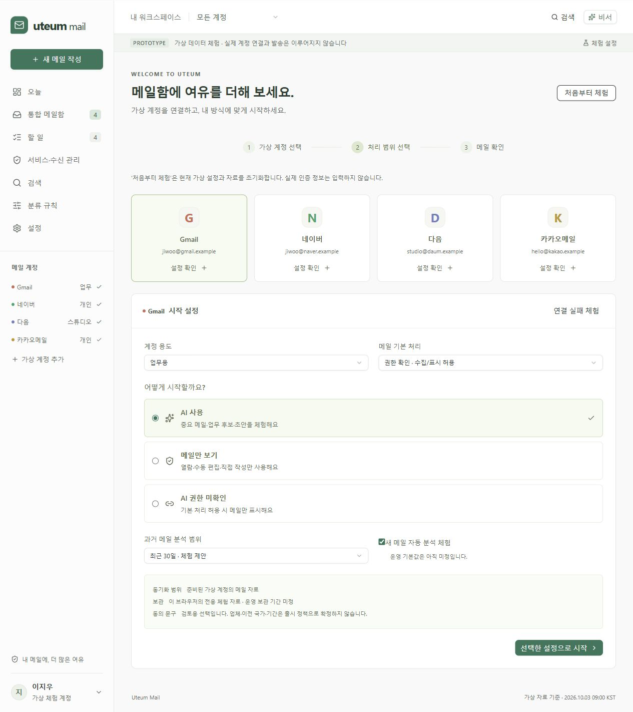

[메일함 선택 화면](assets/review-2026-10-12/01-onboarding.jpg)

### S2 오늘

- 중요한 메일, 오늘 할 일, 답변 대기, 기한이 지난 일을 모아 봅니다.
- 메일과 할 일을 선택해 자세한 내용을 확인합니다.
- 모든 메일함을 함께 보거나 원하는 메일함만 선택합니다.

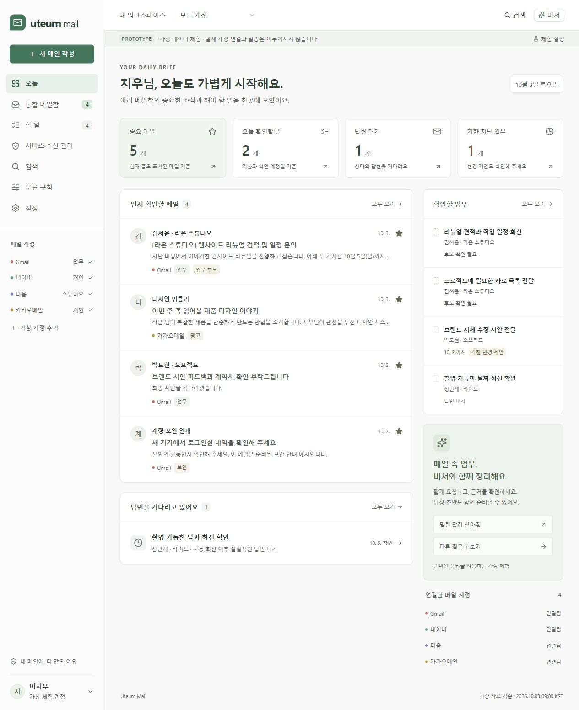

### S3 할 일과 답변 대기

- 메일에서 제안된 할 일을 추가하거나 제외합니다.
- 마감일을 변경하고, 완료한 일을 표시하거나 다시 할 일로 되돌립니다.
- 요청받은 메일을 확인하고 답장을 작성합니다.
- 답장을 보낸 뒤에도 남은 할 일은 유지합니다.

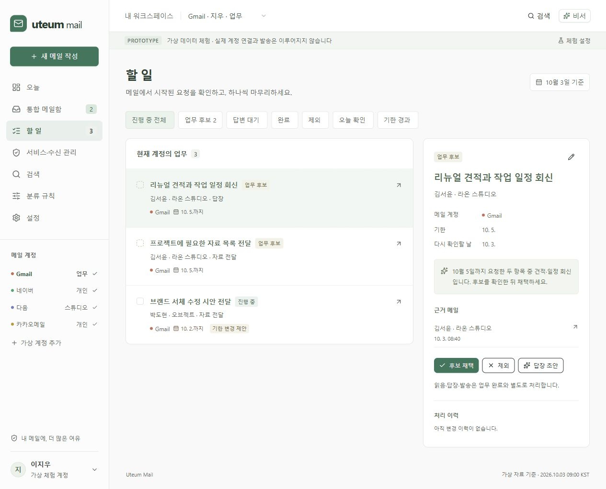

[마감일 변경 결과](assets/review-2026-10-12/03b-deadline.jpg)

### S4 통합 메일함

- 받은 메일, 보낸 메일, 작성 중인 메일을 나누어 봅니다.
- 중요한 메일·읽지 않은 메일·광고만 골라 보거나 검색합니다.
- 메일 내용, 첨부파일 예시, 관련 할 일을 함께 확인합니다.
- 메일 종류와 별개로 중요 표시를 설정합니다.

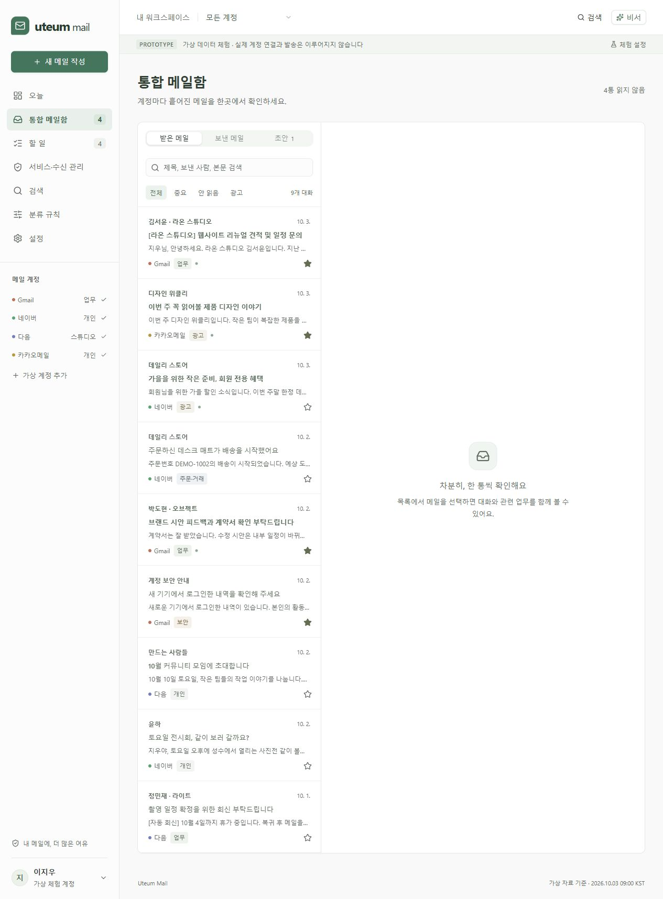

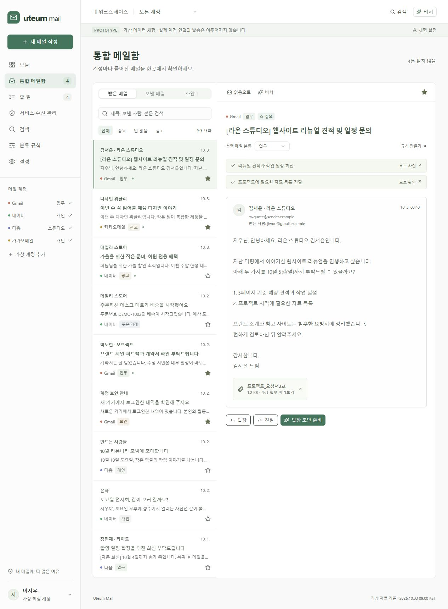

### S5 작성과 초안 검토

- 새 메일과 답장을 작성하거나 받은 메일을 전달합니다.
- 비서가 준비한 예시 글의 받는 사람·제목·본문을 수정합니다.
- 보내기 전 작성한 메일을 저장하고 예시 첨부파일을 추가합니다.
- 내용을 확인한 뒤 ‘모의 발송’으로 발송 과정을 체험합니다.

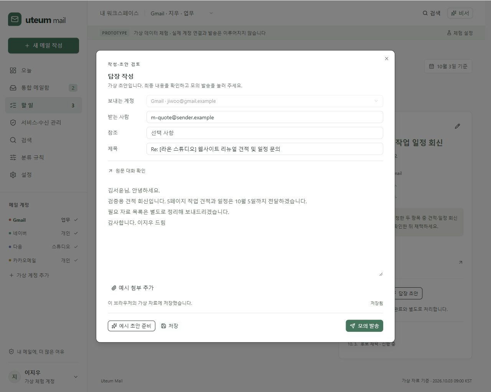

[발송 체험 완료](assets/review-2026-10-12/05b-sent.jpg) · [발송 결과 확인 안내](assets/review-2026-10-12/11-send-unknown.jpg)

### S6 검색과 비서

- ‘견적’, ‘계약서’ 등 원하는 단어로 메일을 검색합니다.
- ‘밀린 답장 찾아줘’, ‘이 메일 답장 써줘’ 같은 준비된 요청을 실행합니다.
- 비서가 제시한 메일과 할 일의 원래 내용을 확인합니다.
- ‘앞으로 라온 견적은 중요하게’처럼 분류 규칙을 요청합니다.

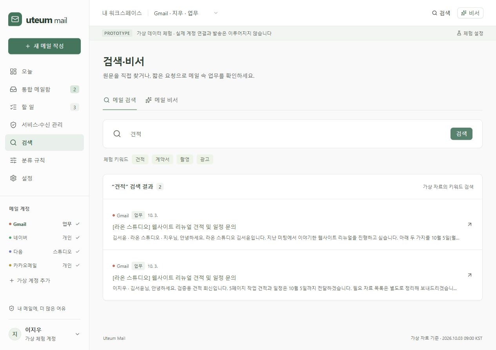

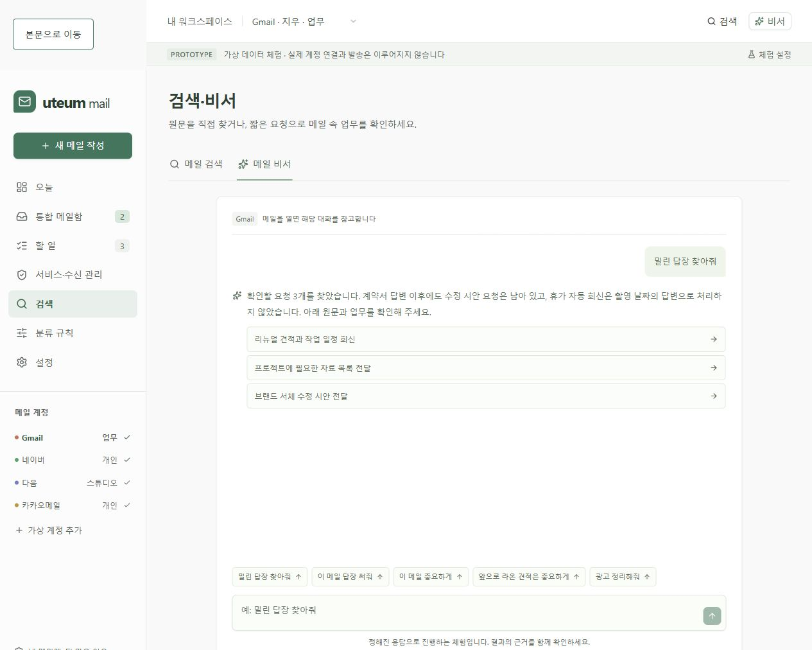

### S7 설정과 자료 관리

- 메일함별 비서 기능을 켜거나 끕니다. 기능을 꺼도 기존 메일과 결과는 남습니다.
- 메일 연결 해제와 보관 자료 삭제를 각각 선택합니다.
- ‘데모 초기화’로 체험 자료를 처음 상태로 되돌립니다.

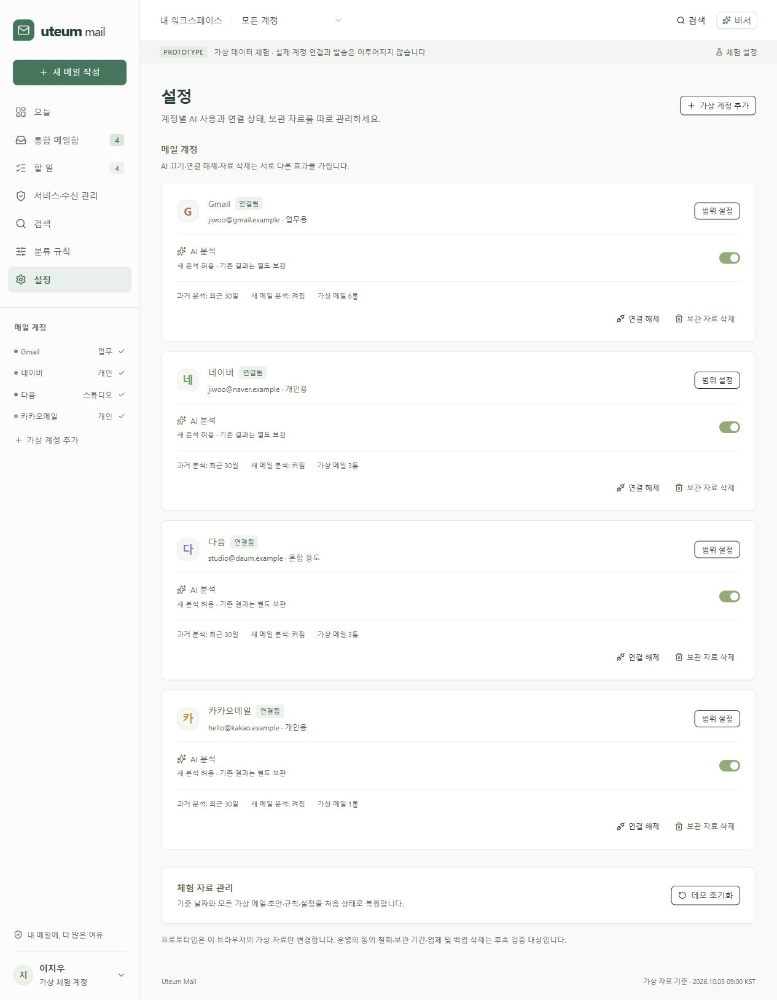

[비서 기능을 껐을 때의 안내](assets/review-2026-10-12/07b-ai-disabled.jpg)

### S8 서비스와 수신 관리

- 소식을 보내는 서비스와 수신 메일함을 확인합니다.
- 서비스를 하나 이상 선택해 광고 수신 해제를 체험합니다.
- 요청 접수, 결과 확인 전, 직접 설정 필요 등의 상태를 구분합니다.
- 주문·배송·보안 안내는 광고와 구분해 유지합니다.

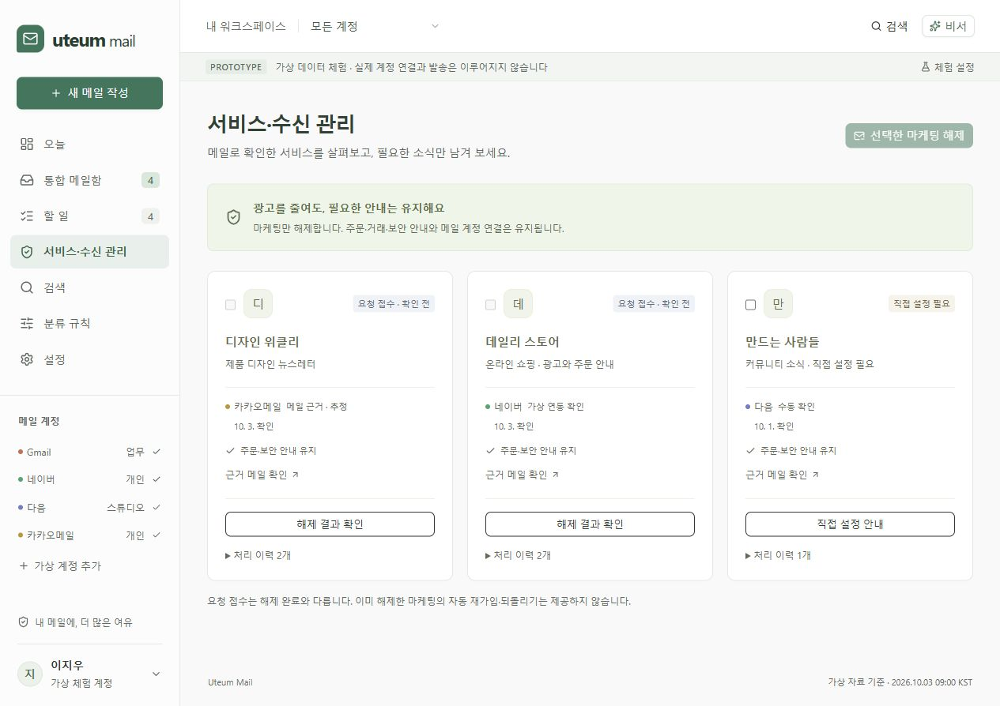

[서비스 목록](assets/review-2026-10-12/08-services.jpg)

### S9 분류 규칙

- 특정 단어가 포함된 메일의 분류 방법을 정합니다. 예: ‘라온’과 ‘견적’이 함께 들어간 메일을 중요하게 표시.
- 적용할 메일함, 예외 조건, 기존 메일과 앞으로 올 메일의 적용 여부를 설정합니다.
- 규칙을 수정·중지·재개하거나 이전 변경을 되돌립니다.

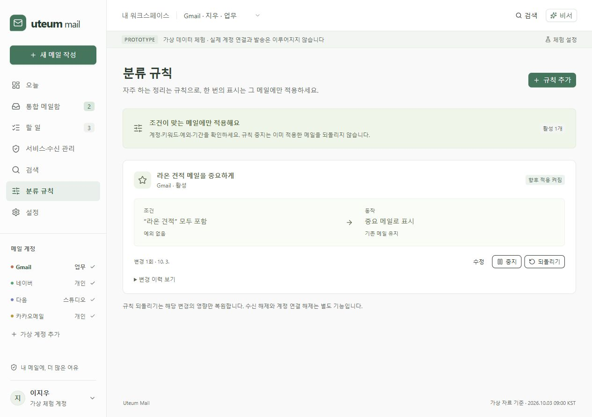

## 3. 기능 확인 결과

### 3.1 확인 방법

2026년 10월 12일, 컴퓨터 화면에서 예시 메일로 주요 기능을 직접 사용하고 자동 검사를 진행했습니다.

| 검사 | 결과 |
| --- | --- |
| 자동 기능 검사 | 26개 모두 통과 |
| 프로그램의 작성 규칙과 실행 준비 상태 검사 | 통과 |
| 확인에 사용한 인터넷 창의 오류 기록 | 오류 0개 |

### 3.2 직접 확인한 기능

| 기능 | 확인 결과 | 상태 |
| --- | --- | --- |
| 메일함 선택 | Gmail 용도와 비서 도움 범위 설정 화면 표시 | 화면 확인 |
| 메일·할 일 이동 | 선택한 메일과 관련 할 일로 이동 | 정상 |
| 할 일 추가·답장 준비 | 할 일 추가 후 보내는 메일함과 받는 사람 자동 입력 | 정상 |
| 답장 수정·저장 | 화면을 새로 열어도 수정한 내용 유지 | 정상 |
| 발송 체험 | 완료 안내 표시, 남은 할 일 유지 | 정상 |
| 마감일 변경 | 10월 2일에서 6일로 변경, 기록 보관 | 정상 |
| 견적 메일 검색 | 선택한 Gmail의 관련 메일 표시 | 정상 |
| 비서의 밀린 답장 조회 | Gmail 할 일 3개 표시, 설명 일부는 메일함과 불일치 | 설명 수정 필요 |
| 분류 규칙 관리 | 생성·중지·되돌리기 반영 | 정상 |
| 광고 수신 해제 체험 | 접수·확인 전 2개, 직접 설정 필요 1개로 구분 | 정상 |
| 비서 기능 끄기 | 새 요청 제한, 기존 메일과 결과 유지 | 정상 |
| 비서 분석 실패 | 오류 안내 후에도 메일 읽기와 직접 답장 작성 가능 | 정상 |
| 발송 결과 미확인 | 재발송 대신 결과 확인 안내, 확인 후 완료 표시 | 정상 |

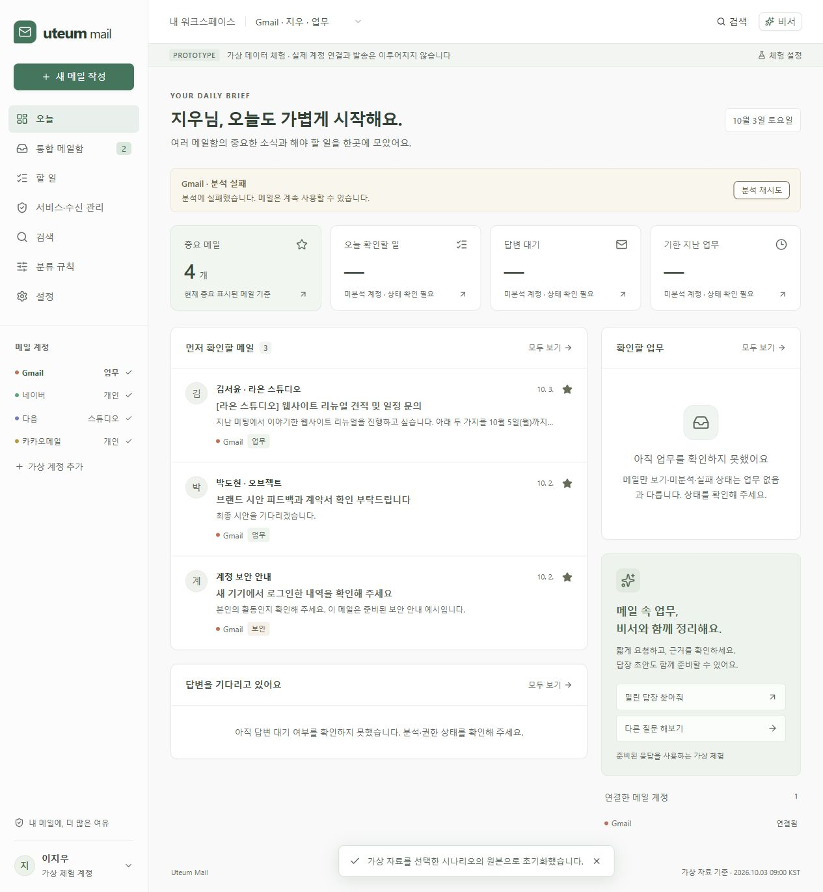

[분석 실패 중 답장 작성](assets/review-2026-10-12/10b-manual-fallback.jpg)

### 3.3 자동 검사로 확인한 기능

- 발송 버튼을 여러 번 눌러도 같은 메일의 중복 생성 방지
- 늦게 준비된 비서 답장이 사용자의 수정 내용을 덮어쓰지 않도록 보호
- 규칙을 되돌릴 때 다른 메일함과 별도로 수정한 내용 유지
- 한 메일함의 자료를 삭제해도 다른 메일함 자료 유지
- 저장 문제 안내와 기존 자료 보호

## 4. 안내 문구 수정 필요

Gmail에서 ‘밀린 답장 찾아줘’를 요청하면 할 일 3개는 올바르게 표시되지만, 설명에 다음 메일함의 촬영 일정 이야기도 포함됩니다. 준비된 설명을 반복 사용해 생기는 문제로, 선택한 메일함의 결과에 맞게 문구를 수정해야 합니다.

## 5. 에이전트 구조

두 그림은 처음 기획한 LLM 구성과 Jev 비교 구성을 표현한 기존 예시입니다. 현재는 GPT Decisions API를 먼저 검증하고 기준 통과 범위를 초기 운영에 사용하며, Jev는 비교 후보로 유지합니다. Luna·Sol은 요청 해석·글쓰기와 복귀 처리를 담당하고, 결정 API는 정해진 선택형 판단을 맡습니다.

### 5.1 처음 기획한 LLM 구조

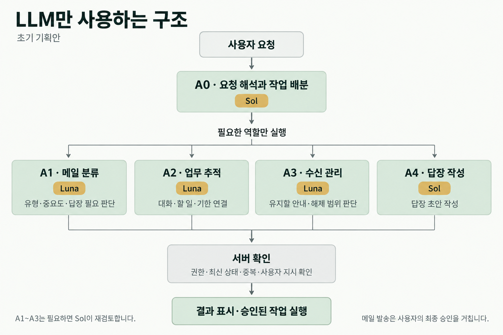

- A0가 요청을 이해하고 메일 분류·업무 추적·수신 관리·답장 작성 중 필요한 역할에 작업을 맡깁니다.
- A1~A3는 Luna, A0와 A4는 Sol을 사용합니다. A1~A3의 판단이 어려우면 Sol이 다시 검토합니다.
- 서버가 권한과 처리 결과를 확인하며, 메일은 사용자가 최종 승인한 뒤 발송합니다.

### 5.2 결정모델을 도입한 구조

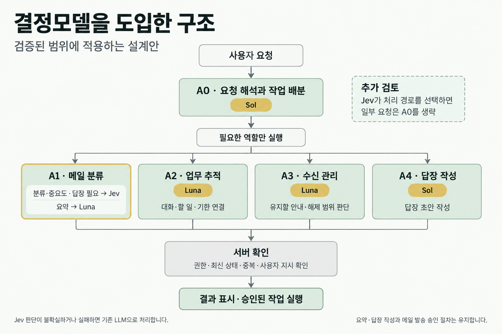

- 검증된 범위에서 메일 분류·중요도·답장 필요 여부를 Jev가 판단하고, 요약과 답장 작성은 기존 LLM이 맡습니다.
- Jev의 판단이 불확실하거나 실패하면 기존 LLM으로 처리합니다. 서버 확인과 발송 승인 절차도 유지합니다.
- Jev가 처리 경로를 골라 일부 요청에서 A0를 생략하는 방식은 추가 검토 대상입니다.

현재 도입 순서는 **Luna·Sol 기준 성능 확인 → GPT Decisions 결과 미반영 검증 → 기준 통과 범위의 초기 운영 사용**입니다. Jev는 위 그림과 같은 구성으로 비교할 후보이며, Jev 비교 완료를 초기 운영의 선행 조건으로 두지 않습니다. 아직 실제 API 호출·한국어 평가·운영 적용을 완료한 것은 아닙니다.

## 6. 함께 볼 자료

- [이전 기능 확인 기록](16-웹-프로토타입-구현-검증-기록-v1.0.md)
- [체험 화면 실행 방법](../apps/web/README.md)
- [에이전트 상세 설계](12-에이전트+결정모델-세부-구조-v1.0.md)
